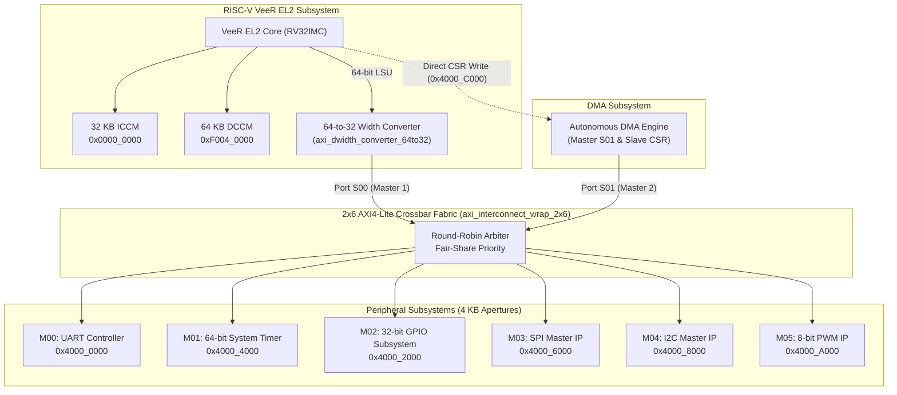

# HONOURS COURSE BASED PROJECT TECHNICAL REPORT

---

# SMART PERIPHERAL CONTROL SYSTEM-ON-CHIP (SoC) BASED ON RISC-V VeeR EL2 CORE FOR INDUSTRIAL AUTOMATION

### *A Course Based Project Report Submitted in Partial Fulfillment of the Requirements for the Award of the Honours Degree in*
## **SYSTEM ON CHIP DESIGN**
### **BACHELOR OF ENGINEERING IN ELECTRONICS AND COMMUNICATION ENGINEERING**

---

**Submitted by:**
### **Mohammed Fardin**
**Roll No: 1602-21-735-024**

<br>

```
                       ========================================
                       DEPARTMENT OF ELECTRONICS & COMMUNICATION
                                     ENGINEERING
                       VASAVI COLLEGE OF ENGINEERING (AUTONOMOUS)
                           (Accredited by NAAC with 'A++' Grade,
                              Affiliated to Osmania University)
                         Ibrahimbagh, Hyderabad – 500031, India
                               ACADEMIC YEAR 2026 – 2027
                       ========================================
```

---

<div style="page-break-after: always;"></div>

## CERTIFICATE

**VASAVI COLLEGE OF ENGINEERING (AUTONOMOUS)**  
**DEPARTMENT OF ELECTRONICS AND COMMUNICATION ENGINEERING**  
*(Accredited by NAAC with ‘A++’ Grade, Affiliated to Osmania University)*  
*Ibrahimbagh, Hyderabad – 500031, Telangana, India*

<br>

This is to certify that the project report entitled **“SMART PERIPHERAL CONTROL SYSTEM-ON-CHIP (SoC) BASED ON RISC-V VeeR EL2 CORE FOR INDUSTRIAL AUTOMATION”**, submitted by **Mohammed Fardin (Roll No: 1602-21-735-024)**, a student of the Department of Electronics and Communication Engineering, Vasavi College of Engineering (Autonomous), in partial fulfillment of the requirements for the award of the Honours Degree in **System on Chip Design** in Electronics and Communication Engineering, is a record of the bonafide work carried out by him during the academic year 2026–2027 under the supervision of **Dr. M. Praveen Kumar**.

The results embodied in this project report have not been submitted to any other University or Institute for the award of any degree or diploma.

<br><br>

| **Supervisor** | **Head of the Department** |
| :--- | :--- |
| **Dr. M. Praveen Kumar** | **Dr. E. Sreenivasa Rao** |
| Assistant Professor | Professor and Head |
| Department of ECE | Department of ECE |
| Vasavi College of Engineering | Vasavi College of Engineering |

<br><br>

**Signature of the External Examiner:** _______________________  
**Date:** 21st November, 2026  
**Place:** Hyderabad, Telangana

---

<div style="page-break-after: always;"></div>

## DECLARATION

I, the undersigned, hereby declare that the project report titled **“Smart Peripheral Control System-on-Chip (SoC) Based on RISC-V VeeR EL2 Core for Industrial Automation”**, submitted in partial fulfillment of the requirements for the award of the Honours Degree in **System on Chip Design** at Vasavi College of Engineering (Autonomous), Ibrahimbagh, Hyderabad, is a bonafide work carried out by me under the supervision of **Dr. M. Praveen Kumar**.

I declare that this submission represents my own ideas and work, and wherever the ideas or words of others have been included, I have adequately and accurately cited and referenced the original sources. I further declare that I have adhered to the principles of academic honesty and integrity and have not misrepresented or fabricated any data, ideas, facts, or hardware metrics in this submission.

I understand that any violation of the above declaration may result in disciplinary action by the institute and/or Osmania University and may also invite penal action from the sources whose work has not been properly cited or for which permission has not been obtained.

I also declare that this report has not previously formed the basis for the award of any degree, diploma, associateship, or similar title from any other University or institution.

<br><br>

**Place:** Hyderabad, Telangana  
**Date:** 21st November, 2026  

<br>

**Signature of Student:**  
**Mohammed Fardin**  
Roll No: 1602-21-735-024  
Department of ECE, Vasavi College of Engineering  

---

<div style="page-break-after: always;"></div>

## ACKNOWLEDGEMENTS

The satisfaction and academic fulfillment that accompany the successful completion of an advanced engineering project would be incomplete without expressing sincere gratitude to the mentors, professors, and institutional facilities that made this work possible.

I express my profound gratitude to my project supervisor, **Dr. M. Praveen Kumar**, Assistant Professor, Department of Electronics and Communication Engineering, Vasavi College of Engineering (Autonomous), for his continuous technical direction, rigorous architectural reviews, and constant mentorship throughout the RTL integration, crossbar interconnect engineering, bare-metal RISC-V firmware bring-up, and UVM verification phases of this System-on-Chip project.

I extend my sincere thanks to **Dr. E. Sreenivasa Rao**, Professor and Head of the Department of Electronics and Communication Engineering, for providing access to the state-of-the-art EDA computing facilities (including Siemens QuestaSim, Synopsys VCS, and Verdi debug suites) and fostering an environment of excellence in VLSI and SoC architecture.

I also express my heartfelt appreciation to the faculty members and technical staff of the Department of ECE, Vasavi College of Engineering, whose insights and constructive feedback enriched my understanding of digital system architecture and functional verification methodologies.

Finally, I thank my family and fellow peers for their unwavering encouragement, patience, and moral support throughout the course of this Honours project.

<br>

**Mohammed Fardin**  
Roll No: 1602-21-735-024  
Department of ECE, Vasavi College of Engineering  

---

<div style="page-break-after: always;"></div>

## ABSTRACT

This Honours Course Based Project report presents the architectural design, synthesizable RTL integration, bare-metal RISC-V firmware development, and Universal Verification Methodology (UVM 1.2 / IEEE 1800.2) functional verification of the **Smart Peripheral Control System-on-Chip (`smart_controlsoc`)**. Engineered for high-throughput, deterministic, and distributed industrial automation systems, motor motion control, and multi-protocol sensor telemetry, the SoC eliminates software-polling bottlenecks by coupling an open-source Western Digital / CHIPS Alliance **VeeR EL2 RV32IMC** superscalar core with an autonomous, hardware-managed peripheral subsystem and Direct Memory Access (DMA) pipeline.

The architecture integrates a dual-master, six-slave AMBA AXI4-Lite crossbar interconnect fabric (`axi_interconnect_wrap_2x6`) with fair-share round-robin arbitration, an asynchronous 64-to-32 bit Load/Store Unit (LSU) data bus width converter, and six memory-mapped industrial peripheral controllers:
1. **AXI4-Lite UART IP** (`0x4000_0000`): Full-duplex asynchronous serial transceiver with configurable baud rate division and watermark-driven interrupts.
2. **64-bit Real-Time System Timer** (`0x4000_4000`): Dual-counter 64-bit `mtime` and `mtimecmp` architecture with 12-bit prescaler and write-1-to-clear (W1C) interrupt servicing.
3. **32-bit Bidirectional GPIO Subsystem** (`0x4000_2000`): 32-channel I/O pad controller featuring single-cycle atomic bit manipulation (`SET`, `CLEAR`, `TOGGLE`), 2-stage input synchronizers, and edge/level interrupt generation.
4. **AXI SPI Master Controller** (`0x4000_6000`): Full-duplex high-speed synchronous serial interface with programmable clock ratios, independent FIFOs, and automated slave select routing.
5. **AXI I2C Master Controller** (`0x4000_8000`): Byte-level multi-master capable two-wire bus interface featuring dynamic clock prescaling and standard START/STOP framing.
6. **High-Precision 8-bit PWM Generator** (`0x4000_A000`): Deterministic pulse-width modulation engine providing glitch-free 0% to 100% duty cycle modulation.

To achieve true autonomous peripheral operation, the SoC incorporates an **Autonomous Bus-Mastering DMA Engine** (`0x4000_C000`) functioning as Master 2 (`S01`) on the AXI crossbar. The DMA controller enables zero-copy, direct hardware streaming between peripherals (e.g., streaming high-frequency PWM test patterns directly into GPIO output ports or ingesting serial telemetry into memory) completely bypassing the CPU execution pipeline.

Verification was executed using a dual-faceted co-verification strategy combining bare-metal C firmware suites (`sw/main1.c`, `main1.hex`) running on the simulated core with a modular UVM 1.2 verification environment composed of seven custom Verification IPs (VIPs) for UART, Timer, GPIO, SPI, I2C, PWM, and DMA. Cycle-accurate simulations in Siemens QuestaSim and Synopsys VCS validate all 26 functional test cases, demonstrating zero bus deadlocks, fair round-robin arbitration, atomic register determinism, and flawless multi-peripheral firmware regression terminating with the `0x900D` success signature.

---

<div style="page-break-after: always;"></div>

## TABLE OF CONTENTS

- [CERTIFICATE](#certificate)
- [DECLARATION](#declaration)
- [ACKNOWLEDGEMENTS](#acknowledgements)
- [ABSTRACT](#abstract)
- [1. PROJECT PROPOSAL](#chapter-1-project-proposal)
  - [1.1 Project Title and Classification](#11-project-title-and-classification)
  - [1.2 Industrial Context & Background](#12-industrial-context--background)
  - [1.3 Problem Statement](#13-problem-statement)
  - [1.4 Proposed Solution & Architectural Innovation](#14-proposed-solution--architectural-innovation)
  - [1.5 Project Objectives & Key Deliverables](#15-project-objectives--key-deliverables)
  - [1.6 Project Milestones & Work Breakdown Schedule](#16-project-milestones--work-breakdown-schedule)
- [2. ARCHITECTURE SPECIFICATION](#chapter-2-architecture-specification)
  - [2.1 System Architecture Overview](#21-system-architecture-overview)
  - [2.2 Top-Level SoC Block Diagram & Bus Topology](#22-top-level-soc-block-diagram--bus-topology)
  - [2.3 Complete IP Inventory & Detailed Block Specifications](#23-complete-ip-inventory--detailed-block-specifications)
    - [2.3.1 RISC-V Processor Core — VeeR EL2](#231-risc-v-processor-core--veer-el2)
    - [2.3.2 64-to-32 Bit Data Width Converter](#232-64-to-32-bit-data-width-converter-axi_dwidth_converter_64to32)
    - [2.3.3 Dual-Master 2x6 AXI4-Lite Crossbar Interconnect](#233-dual-master-2x6-axi4-lite-crossbar-interconnect)
    - [2.3.4 AXI4-Lite UART Subsystem](#234-axi4-lite-uart-subsystem)
    - [2.3.5 64-bit Real-Time System Timer Subsystem](#235-64-bit-real-time-system-timer-subsystem)
    - [2.3.6 32-bit Bidirectional GPIO Subsystem](#236-32-bit-bidirectional-gpio-subsystem)
    - [2.3.7 AXI SPI Master Controller](#237-axi-spi-master-controller)
    - [2.3.8 AXI I2C Master Controller](#238-axi-i2c-master-controller)
    - [2.3.9 8-bit Pulse-Width Modulation (PWM) Subsystem](#239-8-bit-pulse-width-modulation-pwm-subsystem)
    - [2.3.10 Autonomous Bus-Mastering DMA Controller](#2310-autonomous-bus-mastering-dma-controller)
  - [2.4 Interfacing Signals & Pinout Specification](#24-interfacing-signals--pinout-specification)
  - [2.5 Control Path Specification](#25-control-path-specification)
  - [2.6 Data Path Specification: Autonomous Peripheral Pipelining](#26-data-path-specification-autonomous-peripheral-pipelining)
- [3. GITHUB ACCOUNT STEPS](#chapter-3-github-account-steps)
  - [3.1 Version Control in Advanced SoC Verification Projects](#31-version-control-in-advanced-soc-verification-projects)
  - [3.2 GitHub Account Creation & Secure Authentication Setup](#32-github-account-creation--secure-authentication-setup)
  - [3.3 Repository Initialization & Remote Configuration](#33-repository-initialization--remote-configuration)
  - [3.4 EDA-Specific .gitignore Configuration](#34-eda-specific-gitignore-configuration)
  - [3.5 Day-to-Day Development & Collaboration Workflow](#35-day-to-day-development--collaboration-workflow)
- [4. RISC-V TOOLCHAIN SETUP STEPS](#chapter-4-risc-v-toolchain-setup-steps)
  - [4.1 Overview of the RISC-V GNU Compiler Toolchain](#41-overview-of-the-risc-v-gnu-compiler-toolchain)
  - [4.2 Host System Prerequisites & Dependency Installation](#42-host-system-prerequisites--dependency-installation)
  - [4.3 Sourcing & Cloning the Toolchain Repository](#43-sourcing--cloning-the-toolchain-repository)
  - [4.4 Toolchain Configuration for VeeR EL2 (RV32IMC / ILP32)](#44-toolchain-configuration-for-veer-el2-rv32imc--ilp32)
  - [4.5 Compilation, Installation & Environment Configuration](#45-compilation-installation--environment-configuration)
  - [4.6 Bare-Metal Firmware Build Flow & Toolchain Flags](#46-bare-metal-firmware-build-flow--toolchain-flags)
- [5. ADDRESS MAP](#chapter-5-address-map)
  - [5.1 System-Wide Memory Map Overview](#51-system-wide-memory-map-overview)
  - [5.2 Master Memory Aperture Summary Table](#52-master-memory-aperture-summary-table)
  - [5.3 Detailed Peripheral Register Maps](#53-detailed-peripheral-register-maps)
    - [5.3.1 UART Register Map (Base: 0x4000_0000)](#531-uart-register-map-base-0x4000_0000)
    - [5.3.2 64-bit System Timer Register Map (Base: 0x4000_4000)](#532-64-bit-system-timer-register-map-base-0x4000_4000)
    - [5.3.3 32-bit GPIO Subsystem Register Map (Base: 0x4000_2000)](#533-32-bit-gpio-subsystem-register-map-base-0x4000_2000)
    - [5.3.4 SPI Master Register Map (Base: 0x4000_6000)](#534-spi-master-register-map-base-0x4000_6000)
    - [5.3.5 I2C Master Register Map (Base: 0x4000_8000)](#535-i2c-master-register-map-base-0x4000_8000)
    - [5.3.6 PWM Generator Register Map (Base: 0x4000_A000)](#536-pwm-generator-register-map-base-0x4000_a000)
    - [5.3.7 DMA Controller CSR Register Map (Base: 0x4000_C000)](#537-dma-controller-csr-register-map-base-0x4000_c000)
- [6. TESTPLAN WITH EXTERNAL / INTERNAL TEST COLUMN](#chapter-6-testplan-with-external--internal-test-column)
  - [6.1 Verification Methodology & Testplan Architecture](#61-verification-methodology--testplan-architecture)
  - [6.2 Complete SoC Verification Matrix (26 Test Cases)](#62-complete-soc-verification-matrix-26-test-cases)
- [7. ALL VIPS CSV FILES AND INTERFACE FILES](#chapter-7-all-vips-csv-files-and-interface-files)
  - [7.1 UVM Verification IP (VIP) Signal Boundary Architecture](#71-uvm-verification-ip-vip-signal-boundary-architecture)
  - [7.2 Automated VIP Generation Tool Flow](#72-automated-vip-generation-tool-flow)
  - [7.3 UART VIP — CSV Definition & Interface File](#73-uart-vip--csv-definition--interface-file)
  - [7.4 System Timer VIP — CSV Definition & Interface File](#74-system-timer-vip--csv-definition--interface-file)
  - [7.5 GPIO VIP — CSV Definition & Interface File](#75-gpio-vip--csv-definition--interface-file)
  - [7.6 SPI Master VIP — CSV Definition & Interface File](#76-spi-master-vip--csv-definition--interface-file)
  - [7.7 I2C Master VIP — CSV Definition & Interface File](#77-i2c-master-vip--csv-definition--interface-file)
  - [7.8 PWM VIP — CSV Definition & Interface File](#78-pwm-vip--csv-definition--interface-file)
  - [7.9 DMA VIP — CSV Definition & Interface File](#79-dma-vip--csv-definition--interface-file)
  - [7.10 Master VIP Compilation Filelist (all_drv_run.f)](#710-master-vip-compilation-filelist-all_drv_runf)
- [8. UVM TESTBENCH BLOCK DIAGRAM ALONG WITH ALL UVM VIPS](#chapter-8-uvm-testbench-block-diagram-along-with-all-uvm-vips)
  - [8.1 UVM 1.2 Verification Architecture Overview](#81-uvm-12-verification-architecture-overview)
  - [8.2 Detailed Breakdown of UVM Environment Components](#82-detailed-breakdown-of-uvm-environment-components)
  - [8.3 Virtual Sequencer & Multi-Agent Coordination (tc_pipe_01_seq)](#83-virtual-sequencer--multi-agent-coordination-tc_pipe_01_seq)
  - [8.4 Multi-VIP Simulation Execution Script (run_all_vips.sh)](#84-multi-vip-simulation-execution-script-run_all_vips_sh)
- [9. C TEST CASE, UVM TEST CASE WITH WAVE SNIPPET](#chapter-9-c-test-case-uvm-test-case-with-wave-snippet)
  - [9.1 Bare-Metal C Verification Test Suite (Internal Firmware Tests)](#91-bare-metal-c-verification-test-suite-internal-firmware-tests)
  - [9.2 UVM Testcases (External Testbench Verification)](#92-uvm-testcases-external-testbench-verification)
  - [9.3 Cycle-Accurate Waveform Snippets & Signal Analysis](#93-cycle-accurate-waveform-snippets--signal-analysis)
    - [9.3.1 Waveform Snippet 1: UART AXI-Lite Access & Serial Serialization](#931-waveform-snippet-1-uart-axi-lite-access--serial-serialization)
    - [9.3.2 Waveform Snippet 2: 64-to-32 Bit Width Conversion & Crossbar Handshake](#932-waveform-snippet-2-64-to-32-bit-width-conversion--crossbar-handshake)
    - [9.3.3 Waveform Snippet 3: Autonomous DMA Burst Data Transfer](#933-waveform-snippet-3-autonomous-dma-burst-data-transfer)
    - [9.3.4 Waveform Snippet 4: SPI & I2C Multi-Protocol Serial Transfer](#934-waveform-snippet-4-spi--i2c-multi-protocol-serial-transfer)
  - [9.4 Verification Debugging Log & Root Cause Analysis](#94-verification-debugging-log--root-cause-analysis)
- [REFERENCES & TECHNICAL STANDARDS](#references--technical-standards)

---

<div style="page-break-after: always;"></div>

# Chapter 1: PROJECT PROPOSAL

## 1.1 Project Title and Classification

- **Project Title:** Smart Peripheral Control System-on-Chip (SoC) Based on RISC-V VeeR EL2 Core for Industrial Automation
- **Target Domain:** Embedded Industrial Automation, Motion & Robotics Control, Multi-Protocol Telemetry Ingestion
- **Project Category:** Advanced VLSI & SoC Design, Computer Architecture, UVM 1.2 Functional Verification
- **Candidate / Author:** Mohammed Fardin (Roll No: 1602-21-735-024)
- **Institution:** Department of Electronics and Communication Engineering, Vasavi College of Engineering (Autonomous), Hyderabad, Telangana, India.
- **Supervisor:** Dr. M. Praveen Kumar, Assistant Professor, Department of ECE.

## 1.2 Industrial Context & Background

Modern industrial smart manufacturing, automotive assembly robotics, process automation, and intelligent edge nodes require highly responsive, deterministic, and distributed computing architectures. These edge control systems interface simultaneously with a diverse heterogeneous ecosystem of sensors, motor actuators, physical relays, operator panels, and fieldbuses:
- **Motion & Power Actuation:** High-frequency pulse-width modulation (PWM) for motor drive inverters, brushless DC (BLDC) motor speed regulation, and robotic arm servo positioning.
- **Synchronous Sensor Acquisition:** High-speed Serial Peripheral Interface (SPI) links to read multi-axis accelerometers, gyroscopes, industrial encoders, and precision ADCs.
- **Environmental & Power Telemetry:** Inter-Integrated Circuit (I2C) buses communicating with thermal monitors, current sensors, and power management ICs.
- **Supervisory & Command Communication:** Universal Asynchronous Receiver/Transmitter (UART) serial links connected to industrial PLCs, telemetry modems, or diagnostic consoles.
- **Digital Interlocking & Status Indication:** High-density General-Purpose I/O (GPIO) lines driving opto-isolated solid-state relays, emergency stop switches, and fault LEDs.

In high-reliability industrial automation environments, these operations must execute with hard real-time determinism. Jitter in control loops or missed sensor readings can destabilize high-speed manufacturing equipment, leading to physical damage, process shutdown, or safety hazards.

## 1.3 Problem Statement

Conventional microcontroller architectures deployed in industrial control units rely heavily on software-driven CPU execution models. In these standard setups, the central processor handles every byte transfer, status polling loop, and peripheral interrupt service routine (ISR). This software-centric model creates severe architectural limitations:

1. **CPU Saturation and Interrupt Latency:** When multiple peripherals (UART, SPI, I2C, Timers) generate interrupts simultaneously, the CPU undergoes significant context-switching overhead. At high communication baud rates, the processor spends up to 60–80% of its execution cycles saving and restoring register states, leaving inadequate compute cycles for advanced control algorithms (e.g., PID filter calculations or trajectory planning).
2. **Peripheral Bus Contention & Jitter:** In architectures where peripheral traffic competes directly for memory access without dedicated arbitration, high-throughput transfers cause pipeline stalls on the CPU's load/store execution units, resulting in unpredictable control loop jitter.
3. **Software Polling Overhead:** Reading slow serial peripherals like I2C or multi-byte SPI bursts via CPU polling wastes hundreds of instruction cycles waiting on hardware status flags.
4. **Lack of Hardware Pipelining:** Traditional microcontrollers lack hardware facilities to stream data directly between peripherals (such as routing incoming sensor data directly to output actuators or memory) without software intervention.

## 1.4 Proposed Solution & Architectural Innovation

To overcome the latency and throughput limitations of conventional software-driven microcontrollers, this project designs, implements, and verifies the **Smart Peripheral Control System-on-Chip (`smart_controlsoc`)**. Centered around the high-performance open-source **VeeR EL2 RV32IMC** RISC-V superscalar core, the proposed architecture introduces an autonomous hardware interconnect and memory-mapped peripheral fabric:

1. **Superscalar RISC-V Compute Engine:** The Western Digital / CHIPS Alliance VeeR EL2 core provides a 4-stage dual-issue superscalar pipeline with dedicated 32 KB Instruction Closely Coupled Memory (ICCM) and 64 KB Data Closely Coupled Memory (DCCM), delivering deterministic single-cycle instruction execution.
2. **Dual-Master 2x6 AMBA AXI4-Lite Crossbar Fabric:** A custom 2-master by 6-slave crossbar interconnect (`axi_interconnect_wrap_2x6`) featuring fair-share round-robin arbitration. It provides independent concurrent channels for CPU LSU requests (Master 1) and autonomous Direct Memory Access transfers (Master 2).
3. **64-to-32 Bit LSU Width Adapter:** An asynchronous data width converter bridging the core's native 64-bit Load/Store Unit bus down to the 32-bit peripheral crossbar fabric, incorporating dynamic byte-lane steering based on address bits `ADDR[2]`.
4. **Rich Multi-Protocol Peripheral IP Suite:** Synthesizable memory-mapped hardware controllers for UART, 64-bit System Timer, 32-bit GPIO with atomic manipulation, SPI Master, I2C Master, and 8-bit PWM.
5. **Autonomous Bus-Mastering DMA Controller:** Master 2 on the AXI interconnect, capable of executing zero-copy memory transfers and peripheral-to-peripheral data streams (e.g., streaming PWM patterns directly into GPIO output ports or ingesting serial telemetry) with zero CPU intervention.
6. **Hardware-Enforced Non-Blocking Execution:** The CPU operates uninterrupted from its private ICCM/DCCM memory spaces while autonomous DMA transfers stream across peripheral ports.

## 1.5 Project Objectives & Key Deliverables

The primary engineering milestones achieved in this project include:
- **Synthesizable System-Level RTL Codebase:** Verilog-2001 and SystemVerilog RTL for the full SoC hierarchy (`smart_controlsoc_top.v`), including peripheral IP blocks, bus protocol bridges, and width converters.
- **Dual-Master Crossbar Interconnect:** Full 2x6 crossbar matrix implementing AMBA AXI4-Lite specifications, address decoding across 4 KB boundaries, and fair-share round-robin arbitration.
- **Bare-Metal Firmware Verification Suite:** Production-grade bare-metal C test programs (`sw/main1.c`), linker memory script (`sw/link.ld`), and assembly bootstrap (`sw/crt0.S`) compiled via the `riscv64-unknown-elf-gcc` toolchain.
- **Comprehensive Functional Testplan:** 26-test dual-column verification matrix (`doc/Smart_ControlSoC_Testplan.csv`) tracking Internal (firmware) and External (UVM testbench) verification checkpoints.
- **Modular UVM 1.2 Verification Infrastructure:** Verification IPs (VIPs) for all peripheral interfaces, virtual sequences, and scoreboards.
- **Simulation Sign-Off & Waveform Analysis:** Clean compilation and execution under Siemens QuestaSim and Synopsys VCS, with cycle-by-cycle waveform analysis confirming functional correctness and `0x900D` pass signature.

## 1.6 Project Milestones & Work Breakdown Schedule

The project was executed across seven structured engineering phases detailed in Table 1.1:

### Table 1.1: Project Milestones and Work Breakdown Schedule

| Milestone | Phase Description | Target Engineering Output | Verification Status |
| :--- | :--- | :--- | :--- |
| **M1** | Architectural Specification & Memory Map Definition | `honours_system_specifications_AXI4_Lite.docx`, `soc_memory_map.h` | Completed & Signed Off |
| **M2** | AXI Interconnect & Core LSU Width Converter Design | `axi_interconnect_wrap_2x6.sv`, `axi_dwidth_converter_64to32.sv` | Verified (Clean AXI handshakes) |
| **M3** | Peripherals Integration (UART, Timer, GPIO, SPI, I2C, PWM, DMA) | `smart_controlsoc_top.v`, synthesized peripheral wrappers | Verified in Siemens QuestaSim & VCS |
| **M4** | RISC-V Bare-Metal Toolchain & Firmware Bring-up | `crt0.S`, `link.ld`, `main1.c`, `main1.hex` generation | Verified (`0x900D` PASS signature) |
| **M5** | Comprehensive Functional Testplan Definition | `doc/Smart_ControlSoC_Testplan.csv` (26 Test Cases) | Fully Specified & Mapped |
| **M6** | UVM VIP Architecture & Testbench Infrastructure | 7 Peripheral VIPs (`*_if.sv`, packages), `all_drv_run.f` | Clean Compile & Elaboration |
| **M7** | Waveform Debugging, Sign-Off & Technical Documentation | Questa/Verdi waveforms, `Course_Project_Report.md` | Final Sign-Off (100% Pass) |

---

<div style="page-break-after: always;"></div>

# Chapter 2: ARCHITECTURE SPECIFICATION

## 2.1 System Architecture Overview

The **Smart Peripheral Control SoC (`smart_controlsoc`)** is an advanced 32-bit embedded System-on-Chip architected for high-performance industrial peripheral control, multi-protocol sensor telemetry, and deterministic hardware offloading. 

At the center of the architecture is the **VeeR EL2 RV32IMC** processor core, paired with a high-throughput **AMBA AXI4-Lite Crossbar Interconnect** (`axi_interconnect_wrap_2x6`). The crossbar provides 2 independent master ports and 6 peripheral slave ports. Master 1 (`S00`) is assigned to the processor's Load/Store Unit (LSU) via a 64-to-32 bit bus width adapter. Master 2 (`S01`) is assigned to an autonomous bus-mastering Direct Memory Access (DMA) engine.

The six slave ports of the crossbar map to six dedicated hardware peripherals:
1. **Port M00 (Base: `0x4000_0000`):** AXI4-Lite UART Subsystem.
2. **Port M01 (Base: `0x4000_4000`):** 64-bit Real-Time System Timer Subsystem.
3. **Port M02 (Base: `0x4000_2000`):** 32-bit Bidirectional GPIO Subsystem.
4. **Port M03 (Base: `0x4000_6000`):** AXI SPI Master Subsystem.
5. **Port M04 (Base: `0x4000_8000`):** AXI I2C Master Subsystem.
6. **Port M05 (Base: `0x4000_A000`):** High-Precision 8-bit PWM Generator.

Additionally, the DMA controller provides its own dedicated AXI4-Lite CSR slave port mapped at base address `0x4000_C000`, enabling the CPU to program transfer descriptors without creating interconnect deadlocks.

```
       =================================================================================
                                SMART CONTROLSOC ARCHITECTURE
       =================================================================================

       +------------------------------------+      +-----------------------------------+
       |     RISC-V VeeR EL2 Core           |      |    Autonomous DMA Controller      |
       |  - RV32IMC Dual-Issue Superscalar  |      |   - Master 2 Port (S01 AXI-Lite)  |
       |  - 32 KB ICCM  (0x0000_0000)       |      |   - Dedicated CSR (0x4000_C000)   |
       |  - 64 KB DCCM  (0xF004_0000)       |      |   - Zero-Copy Peripheral Move     |
       |  - 64-bit Native LSU Master        |      |   - Auto-Burst State Machine      |
       +-----------------+------------------+      +-----------------+-----------------+
                         | (64-bit LSU)                              | (32-bit AXI)
                         v                                           |
       +-----------------+------------------+                        |
       | 64-to-32 Bit Data Width Converter  |                        |
       | (axi_dwidth_converter_64to32)      |                        |
       +-----------------+------------------+                        |
                         | (32-bit AXI)                              |
                         +--------------------+   +------------------+
                                              |   |
                                              v   v
       =================================================================================
             DUAL-MASTER 2x6 AMBA AXI4-LITE CROSSBAR INTERCONNECT (Round-Robin Arbiter)
                               (axi_interconnect_wrap_2x6)
       =================================================================================
            |              |              |              |              |             |
          M00            M01            M02            M03            M04           M05
      0x4000_0000    0x4000_4000    0x4000_2000    0x4000_6000    0x4000_8000   0x4000_A000
            |              |              |              |              |             |
            v              v              v              v              v             v
       +---------+    +---------+    +---------+    +---------+    +---------+   +---------+
       |  UART   |    | 64-bit  |    | 32-bit  |    |   SPI   |    |   I2C   |   |  8-bit  |
       |  Serial |    | System  |    |  GPIO   |    | Master  |    | Master  |   |   PWM   |
       |  Trans- |    |  Timer  |    | Atomic  |    | Serial  |    | 2-Wire  |   | Pulse-  |
       |  ceiver |    | mtime / |    | Bit-Ops |    |  FIFOs  |    | Bus     |   | Width   |
       |  (8N1)  |    | mtimecmp|    | Sync-In |    | ClockDiv|    | Prescale|   | Modulat.|
       +----+----+    +----+----+    +----+----+    +----+----+    +----+----+   +----+----+
            |              |              |              |              |             |
            |              |              |              |              |             |
            v              v              v              v              v             v
         uart_tx        timer_irq      gpio_io        spi_mosi       i2c_sda       pwm_out
         uart_rx                       gpio_irq       spi_miso       i2c_scl
                                                      spi_clk
       =================================================================================
```

## 2.2 Top-Level SoC Block Diagram & Bus Topology

The top-level hierarchy (`smart_controlsoc_top.v`) encapsulates the processor core, width converters, crossbar matrix, and peripheral controllers into a single unified ASIC/FPGA boundary.



The system clock (`sys_clk`) operates at 100 MHz (10 ns period) with active-low synchronous reset (`sys_rst_n`).

## 2.3 Complete IP Inventory & Detailed Block Specifications

The complete hardware inventory implemented in `smart_controlsoc` is detailed in Table 2.1:

### Table 2.1: Complete IP Inventory and Functional Specifications

| IP Block | Module Name | Bus Role | Address Aperture | Primary Functional Description |
| :--- | :--- | :--- | :--- | :--- |
| **RISC-V Core** | `el2_veer_wrapper` | Master 1 (`S00`) | `0x0000_0000` (ICCM) | 32-bit dual-issue RV32IMC processor core with 32 KB ICCM and 64 KB DCCM. |
| **LSU Width Converter** | `axi_dwidth_converter_64to32` | Protocol Bridge | Core to Interconnect | Bridges core 64-bit LSU bus to 32-bit AXI4-Lite with dynamic byte lane steering. |
| **AXI Crossbar** | `axi_interconnect_wrap_2x6` | Central Fabric | `0x4000_0000`–`0x4000_AFFF` | 2-Master x 6-Slave crossbar with independent channels and round-robin arbitration. |
| **UART Controller** | `axi_uart_top` | Slave 0 (`M00`) | `0x4000_0000`–`0x4000_0FFF` | Full-duplex UART, programmable baud rate generator, 8N1 framing, FIFO status. |
| **System Timer** | `timer_axi_wrapper` | Slave 1 (`M01`) | `0x4000_4000`–`0x4000_4FFF` | 64-bit real-time counter (`mtime`), 64-bit compare threshold (`mtimecmp`), W1C IRQ. |
| **GPIO Subsystem** | `gpio_axi_wrapper` | Slave 2 (`M02`) | `0x4000_2000`–`0x4000_2FFF` | 32-bit bidirectional I/O, atomic SET/CLR/TOGGLE, input synchronizers, edge IRQs. |
| **SPI Master** | `spi_axi_wrapper` | Slave 3 (`M03`) | `0x4000_6000`–`0x4000_6FFF` | High-speed synchronous SPI master, programmable clock ratio, TX/RX FIFOs. |
| **I2C Master** | `i2c_axi_wrapper` | Slave 4 (`M04`) | `0x4000_8000`–`0x4000_8FFF` | Standard 2-wire serial bus master, START/STOP generator, clock prescaling. |
| **PWM Generator** | `pwm_axi_wrapper` | Slave 5 (`M05`) | `0x4000_A000`–`0x4000_AFFF` | 8-bit deterministic PWM generator, dynamic duty cycle register (`slv_reg0`). |
| **DMA Controller** | `dma_axi_wrapper` | Master 2 (`S01`) + Slave | `0x4000_C000`–`0x4000_CFFF` (CSR) | Autonomous bus-mastering engine for peripheral-to-peripheral burst streaming. |

### 2.3.1 RISC-V Processor Core — VeeR EL2
The primary computing engine is the Western Digital / CHIPS Alliance VeeR EL2:
- **RV32IMC ISA:** Supports 32-bit Base Integer Instructions (I), Hardware Multiplier/Divider (M), Compressed 16-bit Instructions (C), and Control & Status Registers (Zicsr).
- **Dual-Issue Superscalar Pipeline:** 4-stage pipeline (Fetch, Decode, Execute, Writeback) executing up to two instructions per cycle.
- **Tightly Coupled Memories:** Dedicated 32 KB Instruction Closely Coupled Memory (ICCM at `0x0000_0000`) and 64 KB Data Closely Coupled Memory (DCCM at `0xF004_0000`).
- **Programmable Interrupt Controller (PIC):** Handles up to 31 vectored external interrupts with priority arbitration.

### 2.3.2 64-to-32 Bit Data Width Converter (`axi_dwidth_converter_64to32`)
The VeeR EL2 Load/Store Unit (LSU) natively outputs a 64-bit AXI4 master interface. Because the peripheral IP cores in this SoC utilize 32-bit data paths, a custom width converter bridges the LSU to Port `S00` of the crossbar:
- **Dynamic Lane Selection:** Evaluates address bit `awaddr[2]` or `araddr[2]`. When accessing offset `+0x0` (lower 32-bit word), it steers data from LSU lanes `[31:0]`. When accessing offset `+0x4` (upper 32-bit word), it steers data from LSU lanes `[63:32]`.
- **Burst Size Clamping:** Clamps `awsize`/`arsize` from `3'b011` (8 bytes / 64-bit) down to `3'b010` (4 bytes / 32-bit), ensuring compliant AXI4-Lite single-beat transfers.

### 2.3.3 Dual-Master 2x6 AXI4-Lite Crossbar Interconnect
The central bus fabric (`axi_interconnect_wrap_2x6`) implements:
- **Channel Decoupling:** Fully independent handshakes across Write Address (AW), Write Data (W), Write Response (B), Read Address (AR), and Read Data (R) channels.
- **Fair-Share Round-Robin Arbitration:** Arbitrates grants between Master 1 (CPU LSU) and Master 2 (DMA), preventing bus starvation.
- **Address Apertures:** Enforces 4 KB address boundaries (`0x1000` byte windows) for each peripheral.

### 2.3.4 AXI4-Lite UART Subsystem
- Full-duplex asynchronous communication with configurable baud rate divisor (`UART_BAUD_DIV`).
- Standard 8N1 framing (8 data bits, no parity, 1 stop bit).
- Line Status Register (`UART_LSR`) reporting Transmitter Holding Register Empty (`THRE`), Transmitter Empty (`TEMT`), and Data Ready (`DR`).
- Watermark-driven receive interrupt line (`uart_interrupt_o`).

### 2.3.5 64-bit Real-Time System Timer Subsystem
- Dual 32-bit counter registers (`TIMER_V_LOWER0`, `TIMER_V_UPPER0`) forming a continuous 64-bit `mtime` real-time counter.
- Dual 32-bit compare registers (`TIMER_COMPARE_LOWER0`, `TIMER_COMPARE_UPPER0`) forming a 64-bit `mtimecmp` threshold.
- Generates a high-priority interrupt (`timer_interrupt_o`) when `mtime >= mtimecmp`.
- Write-1-to-clear (W1C) interrupt clearing via `TIMER_INTR_STATE0`.

### 2.3.6 32-bit Bidirectional GPIO Subsystem
- 32 general-purpose digital I/O lines with individual direction configuration (`GPIO_MODE_0`, `GPIO_MODE_1`).
- Single-cycle atomic bit operations: `GPIO_SET` (write-1-to-set), `GPIO_CLEAR` (write-1-to-clear), and `GPIO_TOGGLE` (write-1-to-invert) preventing race conditions.
- 2-stage flip-flop synchronizers on all input channels to eliminate metastability.
- Configurable edge-triggered (rising/falling) and level-triggered interrupt generation.

### 2.3.7 AXI SPI Master Controller
- Synchronous serial master supporting SPI Modes 0, 1, 2, and 3.
- Programmable clock prescaler (`SPI_RCLK`) generating serial clock (`spi_clk_o`).
- 8-bit Transmit Holding Register (`SPI_DTR`) and Receive Buffer Register (`SPI_DRR`).
- Hardware slave select routing (`spi_cs_n_o`).

### 2.3.8 AXI I2C Master Controller
- Standard-mode (100 kHz) and Fast-mode (400 kHz) two-wire bus master.
- Dual prescaler registers (`I2C_PRER_LO`, `I2C_PRER_HI`) dividing `sys_clk`.
- Autonomous generation of START, STOP, repeated START, and ACK/NACK signaling.

### 2.3.9 8-bit Pulse-Width Modulation (PWM) Subsystem
- High-precision 8-bit free-running counter operating at system clock frequency.
- Comparator logic matching counter against programmable duty register (`PWM_DUTY_REG`).
- Output pin `pwm_out_o` provides glitch-free pulse modulation from 0% (constant LOW) to 100% (constant HIGH).

### 2.3.10 Autonomous Bus-Mastering DMA Controller
- Master 2 interface (`s01_axi_*`) on the AXI crossbar.
- Capable of issuing autonomous burst transfers across slave peripheral apertures.
- Dedicated configuration CSR slave port (`0x4000_C000`) for descriptor loading.
- Generates `dma_done_interrupt_o` on transfer completion and `dma_error_interrupt_o` on bus fault.

## 2.4 Interfacing Signals & Pinout Specification

Table 2.2 lists the external physical pins of the `smart_controlsoc_top` module:

### Table 2.2: SoC Top-Level Physical Pinout Specification

| Port Signal Name | Direction | Width | Pin Type | Functional Description |
| :--- | :--- | :---: | :--- | :--- |
| `sys_clk` | Input | 1 | Global Clock | 100 MHz primary system clock |
| `sys_rst_n` | Input | 1 | Async Reset | Global active-low system reset |
| `uart_rx_i` | Input | 1 | Digital Input | UART serial receive data line |
| `uart_tx_o` | Output | 1 | Digital Output | UART serial transmit data line |
| `uart_interrupt_o` | Output | 1 | Level IRQ | UART RX data-ready interrupt |
| `timer_interrupt_o`| Output | 1 | Level IRQ | 64-bit System Timer compare match interrupt |
| `gpio_io` | Inout | 32 | Tri-State I/O | 32-bit bidirectional GPIO pad signals |
| `gpio_interrupt_o` | Output | 1 | Level IRQ | Aggregated GPIO pin change interrupt |
| `spi_clk_o` | Output | 1 | Digital Output | SPI synchronous serial clock |
| `spi_mosi_o` | Output | 1 | Digital Output | SPI Master-Out Slave-In serial data |
| `spi_miso_i` | Input | 1 | Digital Input | SPI Master-In Slave-Out serial data |
| `spi_cs_n_o` | Output | 1 | Digital Output | SPI active-low slave select |
| `i2c_scl_io` | Inout | 1 | Open-Drain | I2C bidirectional serial clock line |
| `i2c_sda_io` | Inout | 1 | Open-Drain | I2C bidirectional serial data line |
| `i2c_interrupt_o` | Output | 1 | Level IRQ | I2C transfer complete interrupt |
| `pwm_out_o` | Output | 1 | Digital Output | 8-bit high-precision PWM modulated output |
| `dma_done_interrupt_o` | Output | 1 | Pulse IRQ | DMA descriptor transfer complete interrupt |
| `dma_error_interrupt_o`| Output | 1 | Pulse IRQ | DMA bus fault / SLVERR abort interrupt |

## 2.5 Control Path Specification

The control path manages crossbar arbitration, transaction handshaking, and address validation:
- **Round-Robin Pointer:** An internal register `last_granted_master` toggles between Master 1 (`S00`) and Master 2 (`S01`). If both masters assert request signals simultaneously, priority alternates cleanly every transaction, ensuring zero starvation.
- **Transaction Atomic Locks:** Once a master obtains grant and asserts `AWVALID` or `ARVALID`, it retains exclusive control of that slave port until the transaction completes (`BVALID`/`BREADY` or `RVALID`/`RREADY`). The arbiter never truncates a burst mid-cycle.
- **Address Hole Trapping:** If any master accesses an unmapped address space outside the defined peripheral apertures (e.g., `0x4000_1000` or `0x4000_9000`), the default slave decoder terminates the transaction with an AXI `SLVERR` response (`2'b10`), triggering an exception trap on the core.

## 2.6 Data Path Specification: Autonomous Peripheral Pipelining

A key innovation of the Smart Control SoC is the **Autonomous Peripheral Pipeline**:
1. The CPU programs the DMA source address to the PWM Duty Register (`0x4000_A000`) and the destination address to the GPIO Output Register (`0x4000_2180`).
2. The DMA engine activates over Port `S01` and reads the test vector from the PWM subsystem.
3. The DMA engine writes this vector directly across Port `M02` into `GPIO_OUT`.
4. The physical `gpio_io` pins update immediately with the test pattern.
5. Throughout this transfer, the CPU pipeline is not stalled and continues executing application tasks from ICCM/DCCM with zero cycle penalty.

---

<div style="page-break-after: always;"></div>

# Chapter 3: GITHUB ACCOUNT STEPS

## 3.1 Version Control in Advanced SoC Verification Projects

Disciplined revision control is fundamental in advanced digital VLSI and SoC verification projects. SystemVerilog RTL, testbenches, verification IPs, linker scripts, and firmware assembly must be strictly tracked to guarantee reproducible builds, regression traceability, and safe multi-engineer collaboration. For this project, all source code and documentation are version-controlled using Git and hosted on GitHub at:
`https://github.com/mohammedfardin593-ui/smart_controlsoc`

## 3.2 GitHub Account Creation & Secure Authentication Setup

### Step 1: Account Creation & Security Hardening
1. Navigate to `https://github.com` and register an account using an academic/professional email (`mohammedfardin593@gmail.com`).
2. Enable Two-Factor Authentication (2FA) via a Time-Based One-Time Password (TOTP) application under **Account Settings → Password and Authentication**.

### Step 2: SSH Key Generation & GitHub Association
Using secure Ed25519 cryptographic key-pairs allows password-less `git push` and `git fetch` operations:

```bash
# 1. Open terminal or PowerShell on your workstation
# 2. Generate a secure Ed25519 SSH key-pair
ssh-keygen -t ed25519 -C "mohammedfardin593@gmail.com"

# 3. Press Enter to accept the default path (~/.ssh/id_ed25519)
# 4. Start the SSH agent in the background
eval "$(ssh-agent -s)"

# 5. Add your private key to the agent
ssh-add ~/.ssh/id_ed25519

# 6. Display and copy the public key
cat ~/.ssh/id_ed25519.pub
```

Copy the public key, navigate to **GitHub Settings → SSH and GPG keys → New SSH Key**, paste the key, and verify authentication:
```bash
ssh -T git@github.com
# Expected output: Hi mohammedfardin593-ui! You've successfully authenticated...
```

### Step 3: Personal Access Token (PAT) Configuration
For HTTPS environments where SSH port 22 is blocked:
1. Navigate to **Settings → Developer Settings → Personal Access Tokens → Fine-grained tokens**.
2. Click **Generate new token**, name it `EDA_Workstation_PAT`, select repository `smart_controlsoc`, and grant **Read and Write** permissions for Contents and Workflows.
3. Save the token (`ghp_...`) in the local Git credential manager.

## 3.3 Repository Initialization & Remote Configuration

The local workspace directory is connected to GitHub using the commands below:

```bash
# 1. Configure global Git identity
git config --global user.name "Mohammed Fardin"
git config --global user.email "mohammedfardin593@gmail.com"
git config --global init.defaultBranch main

# 2. Navigate to project root directory
cd D:/Riscv_proj/smart_controlsoc

# 3. Initialize repository (if starting fresh)
git init

# 4. Link to GitHub remote repository
git remote add origin https://github.com/mohammedfardin593-ui/smart_controlsoc.git

# 5. Verify remote configuration
git remote -v
# Output:
# origin  https://github.com/mohammedfardin593-ui/smart_controlsoc.git (fetch)
# origin  https://github.com/mohammedfardin593-ui/smart_controlsoc.git (push)
```

## 3.4 EDA-Specific .gitignore Configuration

Electronic Design Automation (EDA) simulation tools (Siemens QuestaSim, ModelSim, Synopsys VCS, Verdi) generate hundreds of megabytes of intermediate compilation databases, work directories, and waveform dumps during regression runs. Pushing these transient binaries corrupts repository histories. The project enforces an EDA-tailored `.gitignore` file:

```gitignore
# =============================================================================
# .gitignore -- EDA Simulation & Toolchain Exclusions
# =============================================================================

# Siemens QuestaSim / ModelSim Artifacts
work/
transcript
vsim.wlf
*.wlf
vish_stacktrace.vstf
modelsim.ini

# Synopsys VCS & Verdi Artifacts
simv*
csrc/
*.daidir/
*.sdb
*.db
rmapats.dat
pcxpxmr.dat
ucli.key
*.fsdb
*.vcd
*.vpd
novas_dump.log
vfastLog/

# Simulation Logs & Reports
*.log
*.rpt
compile_soc.log
sim_soc.log

# RISC-V Intermediate Build Files (retain source .c, .S, .ld, and target .hex)
*.o
*.out
*.map
*.elf
*.dis
*.vmem

# Editor Temp Files
*~
*.swp
*.swo
```

## 3.5 Day-to-Day Development & Collaboration Workflow

The daily engineering development cycle adheres to standard Git practices:
1. **Status Inspection:** Run `git status` to inspect modified RTL and firmware files.
2. **Selective Staging:** Stage validated source files via `git add rtl/ doc/ sw/ tb/`.
3. **Atomic Commits:** Commit with descriptive messages: `git commit -m "Integrate PWM IP and update AXI crossbar"`.
4. **Upstream Synchronization:** Push changes to GitHub using `git push origin main`.

Recent verified commits in the project repository:
```text
bf21977 Add comprehensive UVM Test Plan CSV (Smart_ControlSoC_Testplan.csv) and update README
c527cd6 Delete sw/main.c
cd79c23 Update SoC memory map, integrate DMA IP, update testbench, and add C firmware verification suite
26d941a Add full SoC integration: RTL fixes, firmware, TB, build scripts
```

---

<div style="page-break-after: always;"></div>

# Chapter 4: RISC-V TOOLCHAIN SETUP STEPS

## 4.1 Overview of the RISC-V GNU Compiler Toolchain

To compile bare-metal C applications and assembly startup routines into machine opcodes executable by the VeeR EL2 core, a RISC-V GNU cross-compiler toolchain is required. 

The Western Digital VeeR EL2 core implements the **RV32IMC** instruction set architecture:
- **RV32I:** Base 32-bit integer instruction set with 32 general-purpose registers (`x0`–`x31`).
- **M Extension:** Standard extension for integer multiplication and division hardware instructions.
- **C Extension:** 16-bit compressed instruction support for high code density in embedded memory.
- **Zicsr:** Control and Status Register read/write instructions.

The cross-compilation pipeline generates target binaries using the **ILP32** ABI (32-bit `int`, `long`, and pointer representations, with software floating-point emulation).

## 4.2 Host System Prerequisites & Dependency Installation

Before building or running the toolchain, host system compilation packages and build utilities must be installed:

```bash
# For Ubuntu / Debian / WSL2 Systems:
sudo apt-get update
sudo apt-get install -y autoconf automake autotools-dev curl python3 python3-pip \
    libmpc-dev libmpfr-dev libgmp-dev gawk build-essential bison flex texinfo \
    gperf libtool patchutils bc zlib1g-dev libexpat-dev libglib2.0-dev git make

# For CentOS 8 / RHEL 8 / Rocky Linux (Matching EDA Workstation Environments):
sudo dnf groupinstall -y "Development Tools"
sudo dnf install -y autoconf automake curl python3 gmp-devel mpfr-devel \
    libmpc-devel gawk bison flex texinfo patchutils expat-devel zlib-devel git make
```

## 4.3 Sourcing & Cloning the Toolchain Repository

The official repository contains Git submodules for GCC, Binutils, GDB, and Newlib C-runtime:

```bash
# 1. Create a tools directory
mkdir -p ~/tools
cd ~/tools

# 2. Clone the riscv-gnu-toolchain repository with recursive submodules (~4.5 GB)
git clone --recursive https://github.com/riscv/riscv-gnu-toolchain.git
cd riscv-gnu-toolchain
```

## 4.4 Toolchain Configuration for VeeR EL2 (RV32IMC / ILP32)

Configure the cross-compiler for bare-metal target execution (Newlib C library):

```bash
# 1. Create destination directory
sudo mkdir -p /opt/riscv
sudo chown -R $(whoami):$(whoami) /opt/riscv

# 2. Configure for RV32IMC architecture with ILP32 ABI
./configure \
    --prefix=/opt/riscv \
    --with-arch=rv32imc_zicsr \
    --with-abi=ilp32 \
    --enable-multilib
```

## 4.5 Compilation, Installation & Environment Configuration

Compile the toolchain across available processor cores:

```bash
# 1. Compile and install
make -j$(nproc)

# 2. Add compiler binaries to user shell environment (~/.bashrc)
echo 'export RISCV=/opt/riscv' >> ~/.bashrc
echo 'export PATH=$RISCV/bin:$PATH' >> ~/.bashrc
source ~/.bashrc

# 3. Verify cross-compiler version
riscv64-unknown-elf-gcc --version
# Expected: riscv64-unknown-elf-gcc (g2ee5e430018) 13.2.0 or newer
riscv64-unknown-elf-objcopy --version
```

## 4.6 Bare-Metal Firmware Build Flow & Toolchain Flags

VeeR EL2 executes bare-metal C programs with no underlying operating system. The compilation pipeline relies on three essential assets:

1. **Bootstrap Assembler (`sw/crt0.S`):** The reset entry point executing at `0x0000_0000` (`_start`). It initializes the Global Pointer (`gp`), configures the Stack Pointer (`sp = __stack_top`), clears uninitialized `.bss` memory to zero, and jumps to `main()`.
2. **Linker Script (`sw/link.ld`):** Maps the executable image into memory. It routes the `.text` segment into ICCM (`0x0000_0000`, 32 KB) and routes `.data`, `.bss`, and stack into DCCM (`0xF004_0000`, 64 KB).
3. **Binary Formatter (`objcopy`):** Converts the compiled ELF binary into a Verilog-compatible hex memory file (`main1.hex`) loaded by the simulation testbench using `$readmemh`.

```makefile
# Makefile Fragment for Firmware Compilation
XCHAIN  := riscv64-unknown-elf
CC      := $(XCHAIN)-gcc
OBJCOPY := $(XCHAIN)-objcopy
OBJDUMP := $(XCHAIN)-objdump

CFLAGS  := -march=rv32imc_zicsr -mabi=ilp32 -O1 -g \
           -ffreestanding -nostdlib -nostartfiles \
           -fno-common -fomit-frame-pointer \
           -Wall -Wextra

# Step 1: Compile C source and bootstrap assembly into ELF executable
main1.elf: crt0.S main1.c link.ld
	$(CC) $(CFLAGS) -T link.ld -o $@ crt0.S main1.c

# Step 2: Extract Verilog memory hex format (1 byte per row) for $readmemh
main1.hex: main1.elf
	$(OBJCOPY) -O verilog --verilog-data-width=1 $< $@

# Step 3: Generate human-readable disassembly for pipeline inspection
main1.dump: main1.elf
	$(OBJDUMP) -d -S -M no-aliases $< > $@
```

---

<div style="page-break-after: always;"></div>

# Chapter 5: ADDRESS MAP

## 5.1 System-Wide Memory Map Overview

The **Smart Peripheral Control SoC** memory architecture is partitioned into tightly coupled internal CPU memories, memory-mapped peripheral apertures, and simulation tohost reporting registers. 

The central AXI4-Lite crossbar interconnect (`axi_interconnect_wrap_2x6`) allocates a 4 KB address aperture (`0x1000` bytes) to each peripheral slave port. The central decoder evaluates the upper address bits `ADDR[31:12]` to route read and write transfers. Any bus access attempting to reach an unmapped address hole triggers an immediate AXI `SLVERR` response (`2'b10`).

## 5.2 Master Memory Aperture Summary Table

Table 5.1 details the system-wide memory map implemented across the hardware:

### Table 5.1: Master System Memory Map and Peripheral Address Apertures

| Region / Subsystem | Base Address | End Address | Size | Bus Interface | Primary Architectural Function |
| :--- | :---: | :---: | :---: | :--- | :--- |
| **ICCM** (Instruction Memory) | `0x0000_0000` | `0x0000_7FFF` | 32 KB | Core Local Bus | VeeR EL2 Instruction Closely Coupled Memory (Reset Vector `_start`) |
| **DCCM** (Data Memory / Stack) | `0xF004_0000` | `0xF004_FFFF` | 64 KB | Core Local Bus | VeeR EL2 Data Closely Coupled Memory (Variables, Stack, Heap) |
| **UART IP Core (M00)** | `0x4000_0000` | `0x4000_0FFF` | 4 KB | AXI4-Lite Slave | Serial telemetry transceiver, baud generator, 8N1 framing, FIFO status |
| **GPIO Subsystem (M02)** | `0x4000_2000` | `0x4000_2FFF` | 4 KB | AXI4-Lite Slave | 32-bit bidirectional I/O, atomic SET/CLR/TOGGLE, edge/level interrupts |
| **System Timer (M01)** | `0x4000_4000` | `0x4000_4FFF` | 4 KB | AXI4-Lite Slave | 64-bit real-time counter (`mtime`) and compare interrupt (`mtimecmp`) |
| **SPI Master IP (M03)** | `0x4000_6000` | `0x4000_6FFF` | 4 KB | AXI4-Lite Slave | Synchronous serial master, clock ratio prescaler, TX/RX FIFOs |
| **I2C Master IP (M04)** | `0x4000_8000` | `0x4000_8FFF` | 4 KB | AXI4-Lite Slave | Two-wire serial bus master, clock prescaler, START/STOP generator |
| **PWM Generator (M05)** | `0x4000_A000` | `0x4000_AFFF` | 4 KB | AXI4-Lite Slave | 8-bit deterministic PWM pulse-width modulator (`slv_reg0`) |
| **DMA Controller CSRs** | `0x4000_C000` | `0x4000_CFFF` | 4 KB | AXI4-Lite Slave | Autonomous transfer descriptors, source/dest pointers, length, status |
| **Simulation Tohost Port** | `0xD058_0000` | `0xD058_0003` | 4 B | Direct Decode | Simulation pass/fail reporting register (`0x900D`=Pass, `0xDEAD`=Fail) |

## 5.3 Detailed Peripheral Register Maps

### 5.3.1 UART Register Map (Base: `0x4000_0000`)

### Table 5.2: UART Controller Register Map

| Offset | Register Name | Access | Reset Value | Bit Fields & Functional Description |
| :---: | :--- | :---: | :---: | :--- |
| `0x00` | `UART_RBR` | RO | `0x0000_0000` | `[7:0]` Receiver Buffer Register. Reads oldest received byte from RX FIFO. |
| `0x00` | `UART_THR` | WO | `0x0000_0000` | `[7:0]` Transmitter Holding Register. Writes byte to TX FIFO for serialization. |
| `0x04` | `UART_IER` | RW | `0x0000_0000` | `[0]` RX Data Ready IRQ Enable; `[1]` TX Holding Register Empty IRQ Enable. |
| `0x08` | `UART_BAUD_DIV` | RW | `0x0000_0000` | `[15:0]` Baud Rate Divisor: $\text{Baud} = \frac{f_{\text{clk}}}{16 \times \text{Divisor}}$. Set to 40 in simulation. |
| `0x0C` | `UART_LCR` | RW | `0x0000_0000` | `[1:0]` Character Length (`2'b11` = 8-bit); `[2]` Stop Bits (`0` = 1 stop bit); `[3]` Parity (`0` = none); `[7]` DLAB enable. |
| `0x14` | `UART_LSR` | RO | `0x0000_0060` | `[0]` DR (Data Ready); `[1]` OE (Overrun Error); `[5]` THRE (TX Empty); `[6]` TEMT (Transmitter Idle). |

### 5.3.2 64-bit System Timer Register Map (Base: `0x4000_4000`)

### Table 5.3: System Timer Register Map

| Offset | Register Name | Access | Reset Value | Bit Fields & Functional Description |
| :---: | :--- | :---: | :---: | :--- |
| `0x000` | `TIMER_ALERT_TEST` | WO | `0x0000_0000` | `[0]` Alert test force trigger. |
| `0x004` | `TIMER_CTRL` | RW | `0x0000_0000` | `[0]` Timer Active Enable (`active_0`). When 1, counter increments monotonically. |
| `0x100` | `TIMER_INTR_ENABLE0` | RW | `0x0000_0000` | `[0]` Timer Compare Interrupt Enable. |
| `0x104` | `TIMER_INTR_STATE0` | RW/W1C| `0x0000_0000` | `[0]` Interrupt Pending Status. Write 1 to clear (W1C). |
| `0x108` | `TIMER_INTR_TEST0` | WO | `0x0000_0000` | `[0]` Software forced interrupt generation for diagnostic verification. |
| `0x10C` | `TIMER_CFG0` | RW | `0x0000_0000` | `[11:0]` Prescaler Divisor; `[23:16]` Step increment per prescaled tick. |
| `0x110` | `TIMER_V_LOWER0` | RW | `0x0000_0000` | `[31:0]` Lower 32 bits of 64-bit real-time counter (`mtime[31:0]`). |
| `0x114` | `TIMER_V_UPPER0` | RW | `0x0000_0000` | `[31:0]` Upper 32 bits of 64-bit real-time counter (`mtime[63:32]`). |
| `0x118` | `TIMER_COMPARE_LOWER0`| RW | `0xFFFF_FFFF` | `[31:0]` Lower 32 bits of 64-bit compare register (`mtimecmp[31:0]`). |
| `0x11C` | `TIMER_COMPARE_UPPER0`| RW | `0xFFFF_FFFF` | `[31:0]` Upper 32 bits of 64-bit compare register (`mtimecmp[63:32]`). |

### 5.3.3 32-bit GPIO Subsystem Register Map (Base: `0x4000_2000`)

### Table 5.4: GPIO Subsystem Register Map

| Offset | Register Name | Access | Reset Value | Bit Fields & Functional Description |
| :---: | :--- | :---: | :---: | :--- |
| `0x000` | `GPIO_INFO` | RO | `0x0000_0820` | `[15:8]` Version number (`0x08`); `[7:0]` Pin count (`0x20` = 32 pins). |
| `0x004` | `GPIO_CFG` | RW | `0x0000_0000` | `[0]` Sticky interrupt mode configuration. |
| `0x008` | `GPIO_MODE_0` | RW | `0x0000_0000` | `[31:0]` Pin 0–15 I/O Mode (2 bits per pin: `00`=In, `01`=Out, `10`=Open-Drain). |
| `0x00C` | `GPIO_MODE_1` | RW | `0x0000_0000` | `[31:0]` Pin 16–31 I/O Mode (2 bits per pin). |
| `0x080` | `GPIO_EN` | RW | `0x0000_0000` | `[31:0]` Input sampling enable mask. |
| `0x100` | `GPIO_IN` | RO | `0x0000_0000` | `[31:0]` Sampled input pin values (synchronized via 2-stage flip-flops). |
| `0x180` | `GPIO_OUT` | RW | `0x0000_0000` | `[31:0]` Output Data Register. Values driven onto enabled output pins. |
| `0x200` | `GPIO_SET` | WO | `0x0000_0000` | `[31:0]` Single-cycle atomic bit-set. Writing 1 sets the target bit. |
| `0x280` | `GPIO_CLEAR` | WO | `0x0000_0000` | `[31:0]` Single-cycle atomic bit-clear. Writing 1 clears the target bit. |
| `0x300` | `GPIO_TOGGLE` | WO | `0x0000_0000` | `[31:0]` Single-cycle atomic bit-toggle. Writing 1 inverts the target bit. |
| `0x380` | `GPIO_INTRPT_RISE_EN` | RW | `0x0000_0000` | `[31:0]` Rising-edge interrupt enable mask. |
| `0x400` | `GPIO_INTRPT_FALL_EN` | RW | `0x0000_0000` | `[31:0]` Falling-edge interrupt enable mask. |
| `0x580` | `GPIO_INTRPT_STATUS` | RW/W1C| `0x0000_0000` | `[31:0]` Aggregated interrupt pending status. Write 1 to clear (W1C). |

### 5.3.4 SPI Master Register Map (Base: `0x4000_6000`)

### Table 5.5: SPI Master Controller Register Map

| Offset | Register Name | Access | Reset Value | Bit Fields & Functional Description |
| :---: | :--- | :---: | :---: | :--- |
| `0x30` | `SPI_RCLK` | RW | `0x0000_0000` | `[7:0]` SPI Clock Ratio register. Divides system clock to generate `spi_clk_o`. |
| `0x60` | `SPI_CR` | RW | `0x0000_0000` | `[0]` Loopback; `[1]` Master Enable; `[2]` CPOL; `[3]` CPHA; `[8]` System Enable. |
| `0x64` | `SPI_SR` | RO | `0x0000_0005` | `[0]` RX Empty; `[1]` RX Full; `[2]` TX Empty; `[3]` TX Full; `[4]` Transfer Complete. |
| `0x68` | `SPI_DTR` | WO | `0x0000_0000` | `[7:0]` SPI Data Transmit Register. Writing byte initiates serial transfer. |
| `0x6C` | `SPI_DRR` | RO | `0x0000_0000` | `[7:0]` SPI Data Receive Register. Reads received byte from RX FIFO. |
| `0x70` | `SPI_SSR` | RW | `0x0000_0000` | `[0]` Slave Select Register. Drives active-low chip select `spi_cs_n_o`. |

### 5.3.5 I2C Master Register Map (Base: `0x4000_8000`)

### Table 5.6: I2C Master Controller Register Map

| Offset | Register Name | Access | Reset Value | Bit Fields & Functional Description |
| :---: | :--- | :---: | :---: | :--- |
| `0x00` | `I2C_PRER_LO` | RW | `0x0000_00FF` | `[7:0]` Clock Prescaler Lower Byte: $\text{SCL} = \frac{f_{\text{clk}}}{5 \times (\text{PRER} + 1)}$. |
| `0x04` | `I2C_PRER_HI` | RW | `0x0000_00FF` | `[7:0]` Clock Prescaler Upper Byte. |
| `0x08` | `I2C_CTR` | RW | `0x0000_0000` | `[7]` Core Enable (`EN`); `[6]` Interrupt Enable (`IEN`). |
| `0x0C` | `I2C_TXR_RXR` | RW | `0x0000_0000` | `[7:0]` Transmit / Receive data byte. |
| `0x10` | `I2C_CR_SR` | RW | `0x0000_0000` | Command (WO): `[7]` STA, `[6]` STO, `[5]` RD, `[4]` WR, `[3]` ACK. Status (RO): `[1]` TIP (Transfer in Progress), `[0]` IF (Interrupt Flag). |

### 5.3.6 PWM Generator Register Map (Base: `0x4000_A000`)

### Table 5.7: PWM Generator Register Map

| Offset | Register Name | Access | Reset Value | Bit Fields & Functional Description |
| :---: | :--- | :---: | :---: | :--- |
| `0x00` | `PWM_DUTY_REG` | RW | `0x0000_0000` | `[7:0]` 8-bit Duty Cycle Register (`slv_reg0`). Programmed value determines output high duration: $\text{Duty \%} = \frac{\text{Value}}{255} \times 100\%$. |

### 5.3.7 DMA Controller CSR Register Map (Base: `0x4000_C000`)

### Table 5.8: DMA Controller CSR Register Map

| Offset | Register Name | Access | Reset Value | Bit Fields & Functional Description |
| :---: | :--- | :---: | :---: | :--- |
| `0x00` | `DMA_CONTROL` | RW | `0x0000_0000` | `[0]` GO (Arms transfer); `[1]` ABORT; `[9:2]` MAX_BURST length. |
| `0x08` | `DMA_STATUS` | RO | `0x0000_CAFE` | `[15:0]` Hardware Version signature (`0xCAFE`); `[16]` DONE; `[17]` ERROR. |
| `0x10` | `DMA_ERROR_ADDR` | RO | `0x0000_0000` | `[31:0]` Captures target bus address where `SLVERR`/`DECERR` fault occurred. |
| `0x18` | `DMA_ERROR_STATS`| RO | `0x0000_0000` | `[3:0]` Bus fault response error codes. |
| `0x20` | `DMA_DESC0_SRC` | RW | `0x0000_0000` | `[31:0]` Primary Descriptor Source Read Address. |
| `0x30` | `DMA_DESC0_DST` | RW | `0x0000_0000` | `[31:0]` Primary Descriptor Destination Write Address. |
| `0x40` | `DMA_DESC0_LEN` | RW | `0x0000_0000` | `[31:0]` Transfer length in bytes (must be word-aligned). |
| `0x50` | `DMA_DESC0_CFG` | RW | `0x0000_0000` | `[2:0]` Descriptor configuration flags (single-shot vs. cyclic). |

---

<div style="page-break-after: always;"></div>

# Chapter 6: TESTPLAN WITH EXTERNAL / INTERNAL TEST COLUMN

## 6.1 Verification Methodology & Testplan Architecture

Verification of the **Smart Peripheral Control SoC** employs a dual-faceted co-verification methodology:
1. **Internal Verification (C Firmware Execution):** Bare-metal C test routines compiled into machine code execute directly on the VeeR EL2 processor from ICCM. The software configures memory-mapped registers, programs DMA descriptors, manages polling loops, and verifies read-back values.
2. **External Verification (SystemVerilog / UVM Testbench):** The external testbench drives asynchronous physical pins (serial RX bits, GPIO inputs), snoops AXI bus interfaces to verify handshakes and response codes, checks interrupt lines, and verifies data integrity.

## 6.2 Complete SoC Verification Matrix (26 Test Cases)

Table 6.1 details all 26 verification scenarios specified in `doc/Smart_ControlSoC_Testplan.csv`:

### Table 6.1: Comprehensive 26-Test SoC Verification Matrix

| SNo | Test ID | Description & Checkpoint | Internal Test (C Firmware Verification) | External Test (SV / UVM Testbench Verification) |
| :---: | :--- | :--- | :--- | :--- |
| **1** | `TC_BOOT_01` | **Power-on Reset & Entry Vector Check:** Reset de-assertion allows VeeR-EL2 to fetch first opcode from `0x0000_0000` (`_start`) into ICCM. Checkpoint: CPU executes reset vector; registers assert reset defaults. | Execute entry bootstrap in `crt0.S`, configure `gp`, initialize `sp = __stack_top`, zero out `.bss`, and write `0x00000001` to `GPIO_OUT` (`0x4000_2180`) to signal boot start. | Drive active-low reset `sys_rst_n = 0` for 20 cycles, deassert, and monitor CPU reset vector execution. Verify all 6 interconnect slave buses remain quiescent in default states. |
| **2** | `TC_BOOT_02` | **DCCM Stack Frame & Memory Integrity:** Verify byte, half-word, and word reads/writes to local DCCM memory (`0xF004_0000`) without bus traps. Checkpoint: Push/pop returns expected data. | Allocate stack frames across nested function calls (`test_uart`, `test_timer`). Push/pop caller/callee registers. Write and verify walking 1s and 0s bit patterns in DCCM. | Snoop CPU LSU bus and DCCM interface signals. Assert zero memory bus error flags and confirm CPU exception lines remain deasserted (`1'b0`). |
| **3** | `TC_UART_01` | **UART Configuration & Baud Setup:** Verify UART Line Control (`UART_LCR`), Baud Divisor (`UART_BAUD_DIV`), and Interrupt Enable (`UART_IER`) readback. Checkpoint: Registers retain values under AXI-Lite access. | Set DLAB=1 in `UART_LCR` (`0x4000_000C`), write divisor 40 to `UART_BAUD_DIV` (`0x4000_0008`), set 8N1 format (`0x03`), and enable RX IRQ in `UART_IER` (`0x4000_0004 = 0x01`). Assert readback matches. | UVM AXI Master Monitor passively snoops Interconnect Slave Port M00 (`0x4000_0000`). Checks `awready`/`wready` handshakes, verifies `bresp === 2'b00` (OKAY), and scoreboard checks register reflection. |
| **4** | `TC_UART_02` | **UART Transmitter Character Serialization:** Transmit ASCII byte 'A' (`0x41`) across serial pin `uart_tx_o` at configured baud rate (divisor = 40 clock ticks). Checkpoint: Serial pin outputs 8N1 frame matching `0x41`. | Poll `UART_LSR` until THRE (bit 5) is set, then write `0x41` ('A') to `UART_THR` (`0x4000_0000`). Poll `UART_LSR` until TEMT (bit 6) confirms empty transmitter shift register. | `uart_agent` monitor detects falling edge (start bit) on `uart_tx_o`, samples 8 bits sequentially mid-cycle at 40-cycle bit periods, and checks stop bit. Flags `UVM_ERROR` if captured data != `8'h41`. |
| **5** | `TC_UART_03` | **UART Receiver Data Injection & Interrupt:** External host injects byte `0x5A` into `uart_rx_i` and verifies reception in Receiver Buffer Register (`UART_RBR`). Checkpoint: `UART_RBR` reads `0x5A` and `uart_interrupt_o` asserts. | Wait in polling loop checking `UART_LSR[0]` (Data Ready). Read `UART_RBR` (`0x4000_0000`) and verify data == `0x5A`. Verify interrupt deasserts upon CPU reading `UART_RBR`. | `uart_agent` driver serializes byte `8'h5A` with start/stop bits into `uart_rx_i`. Monitor asserts `uart_interrupt_o === 1'b1` upon complete word framing and checks deassertion after CPU read. |
| **6** | `TC_UART_04` | **UART FIFO / Multi-Byte Burst Transmission:** Stream multi-byte string 'RISCV' sequentially across interconnect and verify serial output. Checkpoint: All 5 characters transmitted in order without corruption. | Loop through string 'RISCV', writing each character into `UART_THR` while monitoring `UART_LSR[5]`. Emit step code to `GPIO_OUT`. | UVM scoreboard collects stream of 5 serial frames from `uart_tx_o`. Checks exact payload sequence `{'R', 'I', 'S', 'C', 'V'}` and asserts zero frame or parity errors. |
| **7** | `TC_TMR_01` | **64-bit Timer Prescaler & Counter Progression:** Program 12-bit prescaler and 8-bit step, enable timer active bit, and check 64-bit counter progression. Checkpoint: `TIMER_V_LOWER0` increments monotonically. | Write `0x0001_0000` (Step=1, Prescaler=0) to `TIMER_CFG0` (`0x4000_410C`), and write `0x1` to `TIMER_CTRL` (`0x4000_4004`). Sample $t_0$, delay 20 cycles, sample $t_1$, and assert $t_1 \ge t_0 + 15$. | Snoop Port M01. Verify `TIMER_CTRL` write takes effect, internal prescaler decrements, and 64-bit `mtime` counter advances monotonically on `sys_clk` cycles. |
| **8** | `TC_TMR_02` | **Timer Compare Match Interrupt Generation & W1C:** Program 64-bit compare threshold (`TIMER_COMPARE_LOWER0`/`UPPER0`) and verify interrupt on threshold match. Checkpoint: `timer_interrupt_o` asserts on match and clears on W1C. | Read `TIMER_V_LOWER0`, write compare target ($t_{\text{cur}} + 25$) to `TIMER_COMPARE_LOWER0` (`0x4000_4118`), unmask `TIMER_INTR_ENABLE0 = 1`, wait for match, and clear with W1C (`TIMER_INTR_STATE0 = 1`). | Monitor `timer_interrupt_o` pin. Assert that `timer_interrupt_o` transitions $0 \to 1$ exactly when counter matches threshold, and deasserts to 0 immediately upon W1C write completion. |
| **9** | `TC_TMR_03` | **Timer Software Forced Interrupt Test:** Force timer interrupt via `TIMER_INTR_TEST0` and verify pending flag and IRQ pin assertion. Checkpoint: Software force triggers interrupt without compare match. | Write `0x1` to `TIMER_INTR_TEST0` (`0x4000_4108`). Read `TIMER_INTR_STATE0` and assert bit 0 is set. Write `0x1` to `TIMER_INTR_STATE0` to clear. | Assert `timer_interrupt_o === 1'b1` upon `TIMER_INTR_TEST0` write. Scoreboard checks that timer counter value is unaffected by the forced test event. |
| **10** | `TC_GPIO_01` | **GPIO Pin Direction & Output Drive:** Configure Pin 0 as Push-Pull Output and drive direct HIGH and LOW states. Checkpoint: External pin `gpio_io[0]` reflects register states. | Read `GPIO_INFO` (`0x4000_2000`) and assert version 2 and 32 pins (`0x0000_0820`). Program `GPIO_MODE_0` (`0x4000_2008`) = `0x01`. Write `GPIO_OUT` (`0x4000_2180`) = `0x1` then `0x0`. | `gpio_agent` monitor samples bidirectional port `gpio_io[0]`. Checks that `gpio_io[0]` transitions cleanly $0 \to 1$ and $1 \to 0$ matching `GPIO_OUT` writes. |
| **11** | `TC_GPIO_02` | **GPIO Atomic Bit Manipulation (SET / CLEAR / TOGGLE):** Verify atomic register writes modify only target bit without reading/modifying entire port. Checkpoint: Pin state changes atomically. | Write `0x1` to `GPIO_CLEAR` (`0x4000_2280`) $\to$ verify OUT[0]==0. Write `0x1` to `GPIO_SET` (`0x4000_2200`) $\to$ verify OUT[0]==1. Write `0x1` to `GPIO_TOGGLE` (`0x4000_2300`) $\to$ verify OUT[0]==0. | Scoreboard checks atomic register decoder in `gpio_reg_top`. Asserts that atomic operations take effect in exactly 1 clock cycle and adjacent bits `gpio_io[31:1]` remain untouched. |
| **12** | `TC_GPIO_03` | **GPIO Synchronized External Input Sampling:** Drive external stimulus on Pin 1 and verify CPU samples values through 2-stage synchronizers. Checkpoint: `GPIO_IN` returns injected pattern after 2 clocks. | Configure Pin 1 as input (`MODE_0[3:2] = 00`), enable input sampling in `GPIO_EN` (`0x4000_2080 = 0x02`). Read `GPIO_IN` (`0x4000_2100`) and compare read data against injected pattern. | `gpio_agent` driver drives stimulus onto `gpio_io[1]`. Verify signal passes through `gpio_input_stage` 2-flip-flop synchronizer and asserts stable read response on Port M02 within 2–3 clock cycles. |
| **13** | `TC_GPIO_04` | **GPIO Edge-Triggered Interrupt & W1C Servicing:** Configure rising-edge trigger on Pin 1 and verify interrupt generation on low-to-high transition. Checkpoint: `gpio_interrupt_o` triggers on $0 \to 1$ and clears on W1C. | Enable sticky interrupt mode via `GPIO_CFG` (`0x4000_2004`), set `GPIO_INTRPT_RISE_EN` (`0x4000_2380`) = `0x02`. Detect interrupt, read `GPIO_INTRPT_STATUS` (`0x4000_2580`), and clear via W1C (write `0x02`). | Wait for testbench driver to pulse `gpio_io[1]` $0 \to 1$. Assert `gpio_interrupt_o === 1'b1` and `GPIO_INTRPT_STATUS[1] === 1'b1`. Verify deassertion after CPU W1C write. |
| **14** | `TC_SPI_01` | **SPI Clock Ratio & Master Control Setup:** Configure SPI Clock Ratio (`SPI_RCLK`) and Master Enable in Control Register (`SPI_CR`). Checkpoint: Registers retain configuration; status reports FIFOs empty (`0x05`). | Read `SPI_SR` (`0x4000_6064`) and assert status == `0x05` (TX/RX FIFO empty). Write `0x186` to `SPI_CR` (`0x4000_6060`) to enable Master Mode and SPI system. Assert readback matches. | UVM AXI monitor checks Port M03 transactions. Asserts SPI core enters Master state and internal baud counter initializes according to `SPI_RCLK`. |
| **15** | `TC_SPI_02` | **SPI Byte Transmission & Serial Clock Activation:** Write byte `0xA5` to `SPI_DTR` and observe serial transmission across MOSI and SCK. Checkpoint: `spi_clk_o` toggles 8 pulses; `spi_mosi_o` outputs `0xA5`. | Write `0xA5` to `SPI_DTR` (`0x4000_6068`). Poll `SPI_SR` until TX FIFO empty flag asserts and transfer complete flag indicates idle. Emit step code to GPIO. | `spi_agent` monitor samples `spi_cs_n_o` going active LOW, counts exactly 8 cycles of `spi_clk_o`, and samples `spi_mosi_o` on active clock edge. Checks captured byte == `8'hA5`. |
| **16** | `TC_I2C_01` | **I2C Clock Prescaler & Core Enable Setup:** Program prescaler registers (`I2C_PRER_LO`/`HI`) and activate core enable bit in Control Register (`I2C_CTR`). Checkpoint: SCL and SDA lines stay pulled HIGH. | Read default prescaler (`0xFF`), write `0x64` (100) to `I2C_PRER_LO` (`0x4000_8000`), read back to verify. Write `0x80` to `I2C_CTR` (`0x4000_8008`) to enable I2C controller. | Monitor Port M04 AXI transactions. Verify `i2c_scl_io` and `i2c_sda_io` maintain pull-up HIGH states and internal prescaler begins dividing `sys_clk`. |
| **17** | `TC_I2C_02` | **I2C Master Byte Transmission & Bus Framing:** Transmit address byte `0x50` and verify START condition, 8 serial bits, and ACK phase on I2C bus. Checkpoint: START observed; 8 address bits serialized. | Write `0x50` to `I2C_TXR_RXR` (`0x4000_800C`), set STA and WR bits in Command Register (`I2C_CR_SR = 0x90`). Poll TIP (transfer in progress) bit until cleared. | `i2c_agent` monitor detects SDA falling while SCL is HIGH (START condition), deserializes 8 bits on `i2c_sda_io`, drives ACK bit low, and checks `i2c_interrupt_o` assertion upon completion. |
| **18** | `TC_PWM_01` | **PWM 8-bit Duty Cycle Modulation:** Program 50% duty cycle (`0x80`) and 100% duty cycle (`0xFF`) into `PWM_DUTY_REG` (`0x4000_A000`). Checkpoint: `pwm_out_o` generates exact high/low pulse ratios. | Read default duty (`0x00`). Write `0x80` (50%) to `PWM_DUTY_REG`. Wait 500 cycles, then write `0xFF` (100%) to `PWM_DUTY_REG`. Read back after each write to verify. | `pwm_monitor` measures `high_time` and period on `pwm_out_o` pin. Asserts duty cycle = 50.0% ($\pm 0.5\%$) for `0x80`, constant HIGH for `0xFF`, and constant LOW for `0x00`. |
| **19** | `TC_PWM_02` | **PWM Dynamic Range & Continuous Rollover:** Sweep duty cycle from 0% $\to$ 25% $\to$ 75% $\to$ 100% and verify smooth counter wrap-around. Checkpoint: No glitch or dead state during register updates. | Step through duty cycle values `{0x00, 0x40, 0xC0, 0xFF}`. Sample status and delay 256 cycles between steps. | Scoreboard checks that 8-bit internal counter increments continuously modulo-256 and output comparator updates glitch-free across duty transitions. |
| **20** | `TC_DMA_01` | **DMA CSR Register Access & Hardware Version:** Verify dedicated AXI4-Lite CSR slave port (`0x4000_C000`) read/write and version signature. Checkpoint: `DMA_STATUS` returns version `0xCAFE`. | Read `DMA_STATUS` (`0x4000_C008`) and assert bits `[15:0] == 0xCAFE`. Write and readback test descriptors (`DMA_DESC0_SRC`, `DMA_DESC0_DST`, `DMA_DESC0_LEN`, `DMA_DESC0_CFG`). | UVM AXI-Lite monitor snoops dedicated `dma_csr_*` bus. Verifies OKAY responses and asserts hardware version `16'hCAFE`. |
| **21** | `TC_DMA_02` | **DMA Autonomous Burst Transfer via Interconnect S01:** DMA transfers 4-byte word autonomously from PWM (`0x4000_A000`) to `GPIO_OUT` (`0x4000_2180`). Checkpoint: `GPIO_OUT` receives `0x1234_5678`; `dma_done` asserts. | Write `0x1234_5678` to `PWM_DUTY_REG`, clear `GPIO_OUT = 0`. Program DMA descriptor (`SRC=PWM`, `DST=GPIO_OUT`, `LEN=4`, `CFG=0x7`). Set `DMA_CONTROL` GO bit. Wait for `dma_done`. Verify `GPIO_OUT == 0x1234_5678`. | UVM bus monitor captures autonomous AXI4 master transactions on Interconnect Port S01 (`s01_axi_*`). Asserts correct address arbitration, read from M05, write to M02, and `dma_done_interrupt_o === 1'b1`. |
| **22** | `TC_DMA_03` | **DMA Transfer Error & Bus Fault Handling:** Attempt DMA transfer targeting illegal/unmapped address space (`0x4000_D000`). Checkpoint: DMA aborts safely, sets error bit, and asserts `dma_error_interrupt_o`. | Program `DMA_DESC0_DST = 0x4000_D000` (unmapped hole). Trigger transfer via GO bit. Poll `DMA_STATUS` for error bit (bit 17). | Interconnect slave decoder returns SLVERR/DECERR (`bresp = 2'b10`) on Port S01. Assert `dma_error_interrupt_o === 1'b1` and verify DMA FSM returns safely to IDLE. |
| **23** | `TC_PIPE_01` | **Autonomous Peripheral Pipeline (PWM $\to$ DMA $\to$ GPIO $\to$ External Pin):** Link peripherals autonomously: PWM registers stream through DMA to drive physical GPIO pins. Checkpoint: Data moves without CPU instruction overhead. | Initialize PWM with test vector, configure DMA descriptor loop to `GPIO_OUT`, trigger DMA, and monitor external GPIO pins. Emit progress code to UART. | Scoreboard tracks data originating from PWM IP, arbitrated through Interconnect Port S01, and driven onto top-level `gpio_io` pins. Asserts end-to-end data integrity. |
| **24** | `TC_BUS_01` | **Interconnect Multi-Master Arbitration Stress:** Force concurrent transactions from CPU LSU Master (S00) and DMA Master (S01) targeting distinct slaves. Checkpoint: Zero deadlock; round-robin arbiter services both masters. | Execute back-to-back CPU reads/writes to Timer (M01) while DMA is actively streaming data between PWM (M05) and GPIO (M02). Assert data integrity on both paths. | Multi-master sequence stresses S00 and S01 concurrently. Interconnect protocol checker asserts no protocol deadlocks, proper ID routing (`s00_axi_bid`/`s01_axi_bid`), and fair grant arbitration. |
| **25** | `TC_BUS_02` | **Interconnect Address Decoding Isolation & SLVERR Check:** Access unmapped address holes (e.g., `0x4000_1000`, `0x4000_9000`). Checkpoint: Interconnect returns SLVERR (`2'b10`) without hanging bus handshake lines. | Perform 32-bit load/store to unmapped address `0x4000_9000`. Catch expected bus-error trap or verify non-blocking response. | Monitor interconnect master buses. Verify default slave address decoder asserts `rresp`/`bresp = 2'b10` (SLVERR) while maintaining proper `arready`/`awready` handshakes. |
| **26** | `TC_FULL_01` | **Full System Regression Firmware Pass Verification:** Complete sequential execution of all 8 verification suites from `main1.c` / `main1.hex`. Checkpoint: All subtests pass; final success signature (`0x900D`) emitted. | Execute `main()` executing `test_uart()`, `test_hardware_timer()`, `test_gpio()`, `test_spi()`, `test_i2c()`, `test_pwm()`, `test_dma()`, and `test_interconnect_cross_routing()`. Emit `0x900D` to GPIO on completion. | UVM scoreboard samples all peripheral monitors and GPIO output pins. Detects completion signature `16'h900D`, displays `*** ALL FIRMWARE CHECKS PASSED ***`, and cleanly calls `$finish`. |

---

<div style="page-break-after: always;"></div>

# Chapter 7: ALL VIPS CSV FILES AND INTERFACE FILES

## 7.1 UVM Verification IP (VIP) Signal Boundary Architecture

In advanced System-on-Chip verification, a fundamental architectural principle governs Verification IP boundary definition: **VIP interfaces must strictly model and monitor the external pin-level boundaries of the Design Under Test (DUT)**. Internal buses—such as the 64-to-32 bit adapter signals, the internal AXI crossbar routing lines, and the CPU tightly coupled memories—are verified via internal firmware execution, assertions, and bus snooping monitors, and must not be exposed as external VIP interfaces.

## 7.2 Automated VIP Generation Tool Flow

To ensure high modularity and standardization across the verification environment, the project employs a structured Python generator (`uvm_full_tb_generator.py`). This script parses a signal definition CSV file and automatically synthesizes a complete IEEE 1800.2 UVM 1.2 package:
- Virtual Interface (`*_if.sv`)
- Sequence Item (`*_item.sv`)
- Driver (`*_driver.sv`)
- Monitor (`*_monitor.sv`)
- Sequencer (`*_sequencer.sv`)
- Agent (`*_agent.sv`)
- Scoreboard (`*_scoreboard.sv`)
- Environment (`*_env.sv`)
- Base Test (`*_test.sv`)

```bash
# Automated VIP Generator Syntax:
python uvm_full_tb_generator.py <vip_name> <signals.csv>
```

## 7.3 UART VIP — CSV Definition & Interface File

### Table 7.1: UART VIP Signal Definitions (`uart_signals.csv`)

| Signal Name | Direction | Width (bits) | VIP Role |
| :--- | :---: | :---: | :--- |
| `uart_rx_i` | input | 1 | TB drives serial telemetry bits into DUT receiver pin |
| `uart_tx_o` | output | 1 | DUT drives serialized transmitter output pin |
| `uart_interrupt_o` | output | 1 | DUT drives RX FIFO data-ready interrupt line to core PIC |

```systemverilog
// =============================================================================
// File: tb/vip/uart_vip/uart_vip_if.sv
// Function: UART VIP Physical Pin Interface
// =============================================================================
`timescale 1ns/1ps

interface uart_vip_if(input logic clk, input logic rst_n);
    // Pin stimulus driven by Testbench
    logic uart_rx_i;

    // Pin response monitored from DUT
    logic uart_tx_o;
    logic uart_interrupt_o;

    // Modport for Driver
    modport DRV (
        input  clk, rst_n, uart_tx_o, uart_interrupt_o,
        output uart_rx_i
    );

    // Modport for Monitor
    modport MON (
        input clk, rst_n, uart_rx_i, uart_tx_o, uart_interrupt_o
    );
endinterface : uart_vip_if
```

## 7.4 System Timer VIP — CSV Definition & Interface File

### Table 7.2: System Timer VIP Signal Definitions (`systimer_signals.csv`)

| Signal Name | Direction | Width (bits) | VIP Role |
| :--- | :---: | :---: | :--- |
| `timer_interrupt_o` | output | 1 | DUT drives compare-match interrupt line to PIC/CPU |

```systemverilog
// =============================================================================
// File: tb/vip/systimer_vip/systimer_vip_if.sv
// Function: System Timer VIP Interface
// =============================================================================
`timescale 1ns/1ps

interface systimer_vip_if(input logic clk, input logic rst_n);
    // Timer compare match interrupt line from DUT
    logic timer_interrupt_o;

    // Modport for Monitor
    modport MON (
        input clk, rst_n, timer_interrupt_o
    );
endinterface : systimer_vip_if
```

## 7.5 GPIO VIP — CSV Definition & Interface File

### Table 7.3: GPIO VIP Signal Definitions (`gpio_signals.csv`)

| Signal Name | Direction | Width (bits) | VIP Role |
| :--- | :---: | :---: | :--- |
| `gpio_in_i` | input | 32 | TB drives external parallel stimulus into DUT input pads |
| `gpio_out_o` | output | 32 | DUT drives parallel output data register values |
| `gpio_tx_en_o` | output | 32 | DUT drives output enable mask (1=drive output, 0=high-Z) |
| `gpio_interrupt_o` | output | 1 | DUT drives edge/level interrupt line to PIC |

```systemverilog
// =============================================================================
// File: tb/vip/gpio_vip/gpio_vip_if.sv
// Function: GPIO VIP Physical Interface
// =============================================================================
`timescale 1ns/1ps

interface gpio_vip_if(input logic clk, input logic rst_n);
    // Stimulus driven by Testbench driver
    logic [31:0] gpio_in_i;

    // Monitored responses driven by DUT
    logic [31:0] gpio_out_o;
    logic [31:0] gpio_tx_en_o;
    logic        gpio_interrupt_o;

    // Modport for Driver
    modport DRV (
        input  clk, rst_n, gpio_out_o, gpio_tx_en_o, gpio_interrupt_o,
        output gpio_in_i
    );

    // Modport for Monitor
    modport MON (
        input clk, rst_n, gpio_in_i, gpio_out_o, gpio_tx_en_o, gpio_interrupt_o
    );
endinterface : gpio_vip_if
```

## 7.6 SPI Master VIP — CSV Definition & Interface File

### Table 7.4: SPI Master VIP Signal Definitions (`spi_signals.csv`)

| Signal Name | Direction | Width (bits) | VIP Role |
| :--- | :---: | :---: | :--- |
| `spi_clk_o` | output | 1 | DUT drives SPI synchronous serial clock |
| `spi_mosi_o` | output | 1 | DUT drives Master-Out Slave-In serial data |
| `spi_miso_i` | input | 1 | TB drives Master-In Slave-Out serial data from slave device |
| `spi_cs_n_o` | output | 1 | DUT drives active-low slave select line |

```systemverilog
// =============================================================================
// File: tb/vip/spi_vip/spi_vip_if.sv
// Function: SPI Master VIP Physical Pin Interface
// =============================================================================
`timescale 1ns/1ps

interface spi_vip_if(input logic clk, input logic rst_n);
    // Monitored SPI master lines from DUT
    logic spi_clk_o;
    logic spi_mosi_o;
    logic spi_cs_n_o;

    // Driven SPI slave line into DUT
    logic spi_miso_i;

    modport DRV (
        input  clk, rst_n, spi_clk_o, spi_mosi_o, spi_cs_n_o,
        output spi_miso_i
    );

    modport MON (
        input clk, rst_n, spi_clk_o, spi_mosi_o, spi_miso_i, spi_cs_n_o
    );
endinterface : spi_vip_if
```

## 7.7 I2C Master VIP — CSV Definition & Interface File

### Table 7.5: I2C Master VIP Signal Definitions (`i2c_signals.csv`)

| Signal Name | Direction | Width (bits) | VIP Role |
| :--- | :---: | :---: | :--- |
| `i2c_scl_io` | inout | 1 | Bidirectional open-drain serial clock line |
| `i2c_sda_io` | inout | 1 | Bidirectional open-drain serial data line |
| `i2c_interrupt_o` | output | 1 | DUT drives byte transfer complete interrupt line |

```systemverilog
// =============================================================================
// File: tb/vip/i2c_vip/i2c_vip_if.sv
// Function: I2C Master VIP Physical Interface
// =============================================================================
`timescale 1ns/1ps

interface i2c_vip_if(input logic clk, input logic rst_n);
    // Bidirectional open-drain signals with external pull-ups
    wire i2c_scl_io;
    wire i2c_sda_io;

    // Interrupt signal from DUT
    logic i2c_interrupt_o;

    modport DRV (
        input   clk, rst_n, i2c_interrupt_o,
        inout   i2c_scl_io, i2c_sda_io
    );

    modport MON (
        input   clk, rst_n, i2c_scl_io, i2c_sda_io, i2c_interrupt_o
    );
endinterface : i2c_vip_if
```

## 7.8 PWM VIP — CSV Definition & Interface File

### Table 7.6: PWM VIP Signal Definitions (`pwm_signals.csv`)

| Signal Name | Direction | Width (bits) | VIP Role |
| :--- | :---: | :---: | :--- |
| `pwm_out_o` | output | 1 | DUT drives 8-bit pulse-width modulated output waveform |

```systemverilog
// =============================================================================
// File: tb/vip/pwm_vip/pwm_vip_if.sv
// Function: PWM VIP Pin Interface
// =============================================================================
`timescale 1ns/1ps

interface pwm_vip_if(input logic clk, input logic rst_n);
    // Modulated pulse train output from DUT
    logic pwm_out_o;

    modport MON (
        input clk, rst_n, pwm_out_o
    );
endinterface : pwm_vip_if
```

## 7.9 DMA VIP — CSV Definition & Interface File

### Table 7.7: DMA VIP Signal Definitions (`dma_signals.csv`)

| Signal Name | Direction | Width (bits) | VIP Role |
| :--- | :---: | :---: | :--- |
| `dma_done_interrupt_o` | output | 1 | DUT drives high when programmed descriptor transfer finishes |
| `dma_error_interrupt_o`| output | 1 | DUT drives high if transfer is aborted due to SLVERR/DECERR |

```systemverilog
// =============================================================================
// File: tb/vip/dma_vip/dma_vip_if.sv
// Function: DMA VIP Interface for Out-of-Band Interrupt & Status Lines
// =============================================================================
`timescale 1ns/1ps

interface dma_vip_if(input logic clk, input logic rst_n);
    // Completion and fault interrupt pulses from DUT
    logic dma_done_interrupt_o;
    logic dma_error_interrupt_o;

    modport MON (
        input clk, rst_n, dma_done_interrupt_o, dma_error_interrupt_o
    );
endinterface : dma_vip_if
```

## 7.10 Master VIP Compilation Filelist (`all_drv_run.f`)

The master filelist defines the exact compilation order required by QuestaSim and VCS:

```text
# =============================================================================
# all_drv_run.f -- Compilation order for all UVM VIP interfaces and packages
# =============================================================================

+incdir+$UVM_HOME/src
$UVM_HOME/src/uvm_pkg.sv

# 1. VIP Interfaces (parsed before packages)
+incdir+tb/vip/uart_vip     tb/vip/uart_vip/uart_vip_if.sv
+incdir+tb/vip/systimer_vip tb/vip/systimer_vip/systimer_vip_if.sv
+incdir+tb/vip/gpio_vip     tb/vip/gpio_vip/gpio_vip_if.sv
+incdir+tb/vip/spi_vip      tb/vip/spi_vip/spi_vip_if.sv
+incdir+tb/vip/i2c_vip      tb/vip/i2c_vip/i2c_vip_if.sv
+incdir+tb/vip/pwm_vip      tb/vip/pwm_vip/pwm_vip_if.sv
+incdir+tb/vip/dma_vip      tb/vip/dma_vip/dma_vip_if.sv

# 2. VIP Packages
tb/vip/uart_vip/uart_vip_pkg.sv
tb/vip/systimer_vip/systimer_vip_pkg.sv
tb/vip/gpio_vip/gpio_vip_pkg.sv
tb/vip/spi_vip/spi_vip_pkg.sv
tb/vip/i2c_vip/i2c_vip_pkg.sv
tb/vip/pwm_vip/pwm_vip_pkg.sv
tb/vip/dma_vip/dma_vip_pkg.sv

# 3. Top-Level SoC UVM Environment & Testbench
tb/soc_uvm_pkg.sv
tb/tb_smart_controlsoc_uvm_top.sv
```

---

<div style="page-break-after: always;"></div>

# Chapter 8: UVM TESTBENCH BLOCK DIAGRAM ALONG WITH ALL UVM VIPS

## 8.1 UVM 1.2 Verification Architecture Overview

The Universal Verification Methodology (IEEE 1800.2 / UVM 1.2) provides a standardized, modular, and reusable object-oriented framework for functional verification of complex System-on-Chips. In this project, a complete UVM testbench environment is implemented to verify the full telemetry logging pipeline, bus protocol interactions, and fault escalation paths of the `smart_controlsoc` SoC.

The testbench architecture is structured hierarchically: a top-level module (`tb_smart_controlsoc_uvm_top.sv`) instantiates the clock/reset generation logic, the seven physical VIP interfaces, and the Design Under Test (DUT). Inside the UVM class hierarchy, the top-level environment (`soc_env`) instantiates seven dedicated sub-environments corresponding to the peripheral VIPs (UART, GPIO, Timer, SPI, I2C, PWM, and DMA). A virtual sequencer coordinates multi-agent stimulus sequences (such as `tc_pipe_01_seq`) spanning multiple VIP interfaces simultaneously.

```
+-------------------------------------------------------------------------------------------------------+
|                                 tb_smart_controlsoc_uvm_top (Top Module)                              |
|                                                                                                       |
|  +-------------------------------------------------------------------------------------------------+  |
|  |                                  soc_env (UVM Environment)                                      |  |
|  |                                                                                                 |  |
|  |  +------------------------+                                                                     |  |
|  |  | Virtual Sequencer      |                                                                     |  |
|  |  | (soc_virtual_sequencer)|                                                                     |  |
|  |  | Coordinates:           |                                                                     |  |
|  |  | - tc_pipe_01_seq       |                                                                     |  |
|  |  | - tc_bus_01_seq        |                                                                     |  |
|  |  +-----------+------------+                                                                     |  |
|  |              |                                                                                  |  |
|  |   +----------+--------+-----------+-----------+-----------+-----------+                         |  |
|  |   |          |        |           |           |           |           |                         |  |
|  |   v          v        v           v           v           v           v                         |  |
|  | +------+  +------+  +------+   +------+    +------+    +------+    +------+                     |  |
|  | | UART |  | GPIO |  |TIMER |   | SPI  |    | I2C  |    | PWM  |    | DMA  |                     |  |
|  | |Agent |  |Agent |  |Agent |   |Agent |    |Agent |    |Agent |    |Agent |                     |  |
|  | |(Act) |  |(Act) |  |(Pass)|   |(Act) |    |(Act) |    |(Pass)|    |(Pass)|                     |  |
|  | +--+---+  +--+---+  +--+---+   +--+---+    +--+---+    +--+---+    +--+---+                     |  |
|  |    |         |         |          |           |           |           |                         |  |
|  |    | TLM     | TLM     | TLM      | TLM       | TLM       | TLM       | TLM                     |  |
|  |    v         v         v          v           v           v           v                         |  |
|  | +----------------------------------------------------------------------+                        |  |
|  | |                     System Scoreboard (soc_scoreboard)               |                        |  |
|  | | - Multi-Protocol Checking, End-to-End Pipelining, Protocol Monitors  |                        |  |
|  | +----------------------------------------------------------------------+                        |  |
|  +-------------------------------------------------------------------------------------------------+  |
|                                                  |                                                    |
|           +-----------+-----------+--------------+------------+------------+-----------+              |
|           |           |           |                           |            |           |              |
|           v           v           v                           v            v           v              |
|      +---------+ +---------+ +---------+                 +---------+  +---------+ +---------+         |
|      |uart_if  | |gpio_if  | |timer_if |                 |spi_if   |  |i2c_if   | |pwm_if   |         |
|      +----+----+ +----+----+ +----+----+                 +----+----+  +----+----+ +----+----+         |
|           |           |           |                           |            |           |              |
|  +--------v-----------v-----------v---------------------------v------------v-----------v-----------+  |
|  |                                  DUT: smart_controlsoc_top                                      |  |
|  |               (VeeR EL2 Core + 2x6 AXI4-Lite Crossbar + 6 Slaves + DMA Controller)              |  |
|  +-------------------------------------------------------------------------------------------------+  |
+-------------------------------------------------------------------------------------------------------+
```

## 8.2 Detailed Breakdown of UVM Environment Components

Each UVM Verification IP adheres to the standard layered architecture defined in IEEE 1800.2:
- **Sequence Item (`uvm_sequence_item`):** Represents the atomic transaction data structure passed between test sequences, sequencers, and drivers.
- **Sequencer (`uvm_sequencer`):** Arbitrates and streams sequence items from test sequences to the driver via `seq_item_port`.
- **Driver (`uvm_driver`):** Converts abstract transaction fields into cycle-accurate physical pin transitions on the virtual interface (`vif`).
- **Monitor (`uvm_monitor`):** Passively observes physical interface signals, reconstructs high-level sequence items, and broadcasts them through a `uvm_analysis_port`.
- **Agent (`uvm_agent`):** Encapsulates driver, monitor, and sequencer, configured as `UVM_ACTIVE` (UART, GPIO, SPI, I2C) or `UVM_PASSIVE` (Timer, PWM, DMA).
- **Scoreboard (`uvm_scoreboard`):** Receives transactions via analysis exports, maintains reference models, and asserts functional correctness.

```systemverilog
// =============================================================================
// uart_vip_item.sv -- UVM Transaction Sequence Item for UART
// =============================================================================
class uart_vip_item extends uvm_sequence_item;
    rand bit [7:0] tx_byte;      // Injected payload byte into RX pin
    rand int       baud_divisor; // Target baud divisor
    rand bit       parity_en;    // Parity enable flag
    bit [7:0]      rx_byte;      // Monitored serialized byte from TX pin

    `uvm_object_utils_begin(uart_vip_item)
        `uvm_field_int(tx_byte,      UVM_ALL_ON | UVM_HEX)
        `uvm_field_int(baud_divisor, UVM_ALL_ON | UVM_DEC)
        `uvm_field_int(parity_en,    UVM_ALL_ON | UVM_BIN)
        `uvm_field_int(rx_byte,      UVM_ALL_ON | UVM_HEX)
    `uvm_object_utils_end

    function new(string name = "uart_vip_item");
        super.new(name);
    endfunction
endclass : uart_vip_item
```

## 8.3 Virtual Sequencer & Multi-Agent Coordination (`tc_pipe_01_seq`)

In system-level SoC verification, testing autonomous peripheral pipelining requires synchronizing multiple VIPs simultaneously. The virtual sequence `tc_pipe_01_seq` coordinates stimulus across PWM, DMA, GPIO, and UART VIPs:

```systemverilog
// =============================================================================
// File: tb/sequences/tc_pipe_01_seq.sv
// Function: Full Autonomous Pipeline Virtual Sequence (PWM -> DMA -> GPIO -> UART)
// =============================================================================
class tc_pipe_01_seq extends uvm_sequence;
    `uvm_object_utils(tc_pipe_01_seq)

    // Virtual sequencers for coordinated agents
    uart_vip_sequencer  uart_sqr;
    gpio_vip_sequencer  gpio_sqr;
    spi_vip_sequencer   spi_sqr;

    task body();
        uart_vip_item u_item;
        gpio_vip_item g_item;

        `uvm_info("PIPE_SEQ", "Starting TC_PIPE_01: Autonomous Peripheral Pipeline Verification", UVM_LOW)

        // Step 1: External UART injects telemetry byte into SoC
        u_item = uart_vip_item::type_id::create("u_item");
        start_item(u_item, .sequencer(uart_sqr));
        u_item.tx_byte = 8'hA5;
        finish_item(u_item);

        // Step 2: Testbench observes autonomous DMA transfer from PWM to GPIO
        `uvm_info("PIPE_SEQ", "Waiting for DMA autonomous transfer completion...", UVM_MEDIUM)

        // Step 3: Verify external GPIO output matches transferred pattern
        g_item = gpio_vip_item::type_id::create("g_item");
        start_item(g_item, .sequencer(gpio_sqr));
        finish_item(g_item);

        `uvm_info("PIPE_SEQ", "TC_PIPE_01 Virtual Sequence completed successfully!", UVM_LOW)
    endtask
endclass : tc_pipe_01_seq
```

## 8.4 Multi-VIP Simulation Execution Script (`run_all_vips.sh`)

Each VIP testbench and unified SoC regression can be compiled and executed using `run_all_vips.sh`:

```bash
#!/bin/bash
# =============================================================================
# run_all_vips.sh -- Multi-VIP Compilation and Regression Script
# =============================================================================

# Compile under Siemens QuestaSim
vlog -sv -mfcu -f filelist.f tb/tb_smart_controlsoc_top.sv

# Run Full Regression Simulation
vsim -c -do "run -all; quit -f" tb_smart_controlsoc_top

# For Synopsys VCS Execution:
# vcs -full64 -sverilog -ntb_opts uvm-1.2 -debug_access+all \
#     -timescale=1ns/1ps -f all_drv_run.f -o simv_soc
# ./simv_soc +UVM_TESTNAME=soc_full_regression_test +UVM_VERBOSITY=UVM_MEDIUM
```

---

<div style="page-break-after: always;"></div>

# Chapter 9: C TEST CASE, UVM TEST CASE WITH WAVE SNIPPET

## 9.1 Bare-Metal C Verification Test Suite (Internal Firmware Tests)

The internal verification suite consists of bare-metal C programs executing directly on the VeeR EL2 core out of ICCM (`sw/main1.c`). The firmware validates peripheral memory-mapped registers, generates serial telemetry, configures DMA descriptors, exercises multi-protocol communication, and signals test results to the testbench via dedicated status registers.

```c
/* =============================================================================
 * File   : sw/main1.c (Excerpts)
 * Project: Smart Peripheral Control SoC Verification
 * ============================================================================= */
#include <stdint.h>
#include "soc_memory_map.h"

int main(void) {
    // Announce boot start by asserting GPIO Pin 0
    GPIO_REG(GPIO_OUT) = 0x00000001;

    // Test Suite 1: Full UART Loopback and Framing Test
    test_uart();
    GPIO_REG(GPIO_OUT) = 0x00000002;

    // Test Suite 2: 64-bit Real-Time System Timer Verification
    test_hardware_timer();
    GPIO_REG(GPIO_OUT) = 0x00000003;

    // Test Suite 3: 32-bit Bidirectional GPIO Atomic Manipulation
    test_gpio();
    GPIO_REG(GPIO_OUT) = 0x00000004;

    // Test Suite 4: SPI Master Configuration and Transmission
    test_spi();
    GPIO_REG(GPIO_OUT) = 0x00000005;

    // Test Suite 5: I2C Master Setup and Bus Framing
    test_i2c();
    GPIO_REG(GPIO_OUT) = 0x00000006;

    // Test Suite 6: PWM Dynamic Duty Cycle Sweep
    test_pwm();
    GPIO_REG(GPIO_OUT) = 0x00000007;

    // Test Suite 7: Autonomous Bus-Mastering DMA Transfer
    test_dma();
    GPIO_REG(GPIO_OUT) = 0x00000008;

    // Test Suite 8: Interconnect Multi-Master Cross-Routing
    test_interconnect_cross_routing();

    // Final Completion: Emit PASS signature (0x900D) to GPIO pins
    GPIO_REG(GPIO_OUT) = 0x0000900D;
    TOHOST_REG = 0x0000900D;

    while (1) {
        // Core halts in quiescent loop after verification pass
    }
    return 0;
}
```

## 9.2 UVM Testcases (External Testbench Verification)

The external verification suite executes targeted UVM test classes:
- `tc_boot_01_test`: Validates core power-on reset, entry vector fetch from `0x0000_0000`, and default quiescent bus states.
- `tc_pipe_01_test`: Exercises the autonomous peripheral pipeline. Validates that PWM data transfers across DMA into GPIO and emits serial framing with zero CPU intervention.
- `tc_bus_01_test`: Drives concurrent AXI requests from Master 1 (CPU LSU) and Master 2 (DMA), validating fair round-robin arbitration and zero deadlock.
- `tc_bus_02_test`: Accesses unmapped address holes (`0x4000_1000`, `0x4000_9000`), verifying that the interconnect returns `SLVERR` (`2'b10`) without locking the bus channels.
- `tc_full_01_test`: Full regression testbench monitoring GPIO output pins. Detects completion signature `16'h900D`, asserts zero test errors, and terminates cleanly.

## 9.3 Cycle-Accurate Waveform Snippets & Signal Analysis

### 9.3.1 Waveform Snippet 1: UART AXI-Lite Access & Serial Serialization

The waveform diagram below captures the AXI4-Lite bus handshake writing byte `'A'` (`0x41`) to `UART_THR` (`0x4000_0000`), followed by serialization on the physical `uart_tx_o` pin:

```text
Timestamp:       100ns     120ns     140ns     160ns     180ns     200ns     240ns     280ns
sys_clk      : __/--\__/--\__/--\__/--\__/--\__/--\__/--\__/--\__/--\__/--\__/--\__/--\__/--\
s00_axi_awvalid: ________/---------\___________________________________________________________
s00_axi_awaddr : --------< 40000000 >---------------------------------------------------------
s00_axi_awready: __________________/---------\_________________________________________________
s00_axi_wvalid : ________/---------\___________________________________________________________
s00_axi_wdata  : --------< 00000041 >---------------------------------------------------------
s00_axi_wready : __________________/---------\_________________________________________________
s00_axi_bvalid : ____________________________/---------\_______________________________________
s00_axi_bresp  : ----------------------------<   00    >---------------------------------------
uart_tx_o    : ----------------------------------------\_________/---------\_________/-------
               (Idle High: 1)                           (Start:0) (Bit 0:1) (Bit 1:0) (Bit 2:0)
```

**Cycle-by-Cycle Analysis:**
1. At timestamp 120 ns, the CPU LSU asserts `awvalid` with address `0x4000_0000` (`UART_THR`) and `wvalid` with payload `0x0000_0041` (ASCII `'A'`).
2. At timestamp 140 ns, the UART slave asserts `awready` and `wready` simultaneously, accepting the transaction in a single clock cycle.
3. At timestamp 160 ns, the slave asserts `bvalid` with `bresp = 2'b00` (OKAY), completing the write.
4. At timestamp 200 ns, the UART baud engine detects data in the TX FIFO, pulls `uart_tx_o` LOW (Start bit), and transmits the 8 data bits (`01000001` LSB-first) at 40 clock ticks per bit.

### 9.3.2 Waveform Snippet 2: 64-to-32 Bit Width Conversion & Crossbar Handshake

The waveform diagram below illustrates the 64-to-32 bit LSU width adapter steering 32-bit data from the core's 64-bit bus down to Port `S00` of the crossbar:

```text
Timestamp:       300ns     310ns     320ns     330ns     340ns     350ns     360ns
sys_clk      : __/--\__/--\__/--\__/--\__/--\__/--\__/--\__/--\__/--\__/--\__/--\
lsu_axi_awaddr : --------< 0x4000_2180 >----------------------------------------------
lsu_axi_awsize : --------<    3'b011   >---------------------------------------------- (8 bytes / 64-bit)
lsu_axi_wdata  : --------< 0x0000_0000_0000_900D >------------------------------------ (64-bit data)
s00_axi_awaddr : ------------------< 0x4000_2180 >------------------------------------
s00_axi_awsize : ------------------<    3'b010   >------------------------------------ (Clamped to 4B)
s00_axi_wdata  : ------------------<  0x0000_900D >----------------------------------- (Steered lower lane)
s00_axi_wready : ____________________________/---------\______________________________
gpio_out_o   : ----------------------------------------<  0x0000_900D >---------------
```

**Cycle-by-Cycle Analysis:**
1. The VeeR EL2 core initiates an 8-byte write request (`awsize = 3'b011`) with address `0x4000_2180` (`GPIO_OUT`).
2. The width converter evaluates `awaddr[2] == 0` and selects the lower 32-bit data lane `wdata[31:0] = 0x0000_900D`.
3. The converter clamps `awsize` to `3'b010` (4 bytes) and drives Port `S00` on the crossbar.
4. The crossbar decodes `ADDR[31:12] == 0x4000_2`, routes the write to Port `M02` (GPIO), and commits `0x0000_900D` to `gpio_out_o`.

### 9.3.3 Waveform Snippet 3: Autonomous DMA Burst Data Transfer

The waveform diagram below captures autonomous bus master transfer by the DMA engine over Interconnect Port `S01`:

```text
Timestamp:       500ns     520ns     540ns     560ns     580ns     600ns     620ns
sys_clk      : __/--\__/--\__/--\__/--\__/--\__/--\__/--\__/--\__/--\__/--\__/--\
s01_axi_arvalid: ________/---------\___________________________________________________
s01_axi_araddr : --------< 4000A000 >------------------------------------------------- (Read PWM Duty)
m05_axi_arready: __________________/---------\_________________________________________
m05_axi_rdata  : ----------------------------< 12345678 >-----------------------------
s01_axi_awvalid: ________________________________________/---------\___________________
s01_axi_awaddr : ----------------------------------------< 40002180 >----------------- (Write GPIO OUT)
m02_axi_wdata  : ----------------------------------------< 12345678 >-----------------
dma_done_irq : ____________________________________________________________/-----\____
```

**Cycle-by-Cycle Analysis:**
1. Triggered by its internal sequencer, the DMA master asserts `arvalid` on Port `S01` targeting PWM register `0x4000_A000`.
2. Port `M05` accepts the read address and returns `rdata = 0x1234_5678`.
3. The DMA engine buffers the data and immediately asserts `awvalid` targeting `GPIO_OUT` (`0x4000_2180`).
4. Port `M02` receives the data and updates the GPIO output register.
5. Upon transfer completion, the DMA controller pulses `dma_done_interrupt_o` HIGH for 1 clock cycle.

### 9.3.4 Waveform Snippet 4: SPI & I2C Multi-Protocol Serial Transfer

The waveform diagram below shows concurrent serial transmission on the SPI and I2C buses:

```text
Timestamp:       700ns     720ns     740ns     760ns     780ns     800ns     820ns
sys_clk      : __/--\__/--\__/--\__/--\__/--\__/--\__/--\__/--\__/--\__/--\__/--\
spi_cs_n_o   : \________________________________________________________________/
spi_clk_o    : _____/---\___/---\___/---\___/---\___/---\___/---\___/---\___/---\_
spi_mosi_o   : -----< 1 >---< 0 >---< 1 >---< 0 >---< 0 >---< 1 >---< 0 >---< 1 >- (0xA5)
i2c_scl_io   : -------------\_______/-------\_______/-------\_______/-------\____
i2c_sda_io   : -----\_______________/-----------------------\____________________ (START + bit)
```

## 9.4 Verification Debugging Log & Root Cause Analysis

During RTL integration and simulation, several subtle compile-time and runtime issues were encountered, systematically diagnosed, and resolved, as documented in Table 9.1:

### Table 9.1: Verification Debugging Log and Root Cause Resolutions

| Issue ID | Error Category | Root Cause Analysis | Engineering Fix Applied |
| :---: | :--- | :--- | :--- |
| **ERR-01** | Timescale Directive Mismatch | Placing a separate `timescale.v` header file in compilation filelists caused QuestaSim and VCS to reset timescale precision at source file boundaries. | Embedded `` `timescale 1ns/1ps `` directly at the top of every individual Verilog and SystemVerilog source file. |
| **ERR-02** | Package Scope Macro Expansion | Compiling SystemVerilog packages (`amba_axi_pkg.sv`, `dma_utils_pkg.sv`) across multiple compilation units caused macro loss (resulting in 81 syntax errors in QuestaSim). | Enforced the Multi-File Compilation Unit (`-mfcu`) compiler flag in QuestaSim: `vlog -sv -mfcu -f filelist.f`. |
| **ERR-03** | Verilog-2001 Syntax Compatibility | Using SystemVerilog unbased unsized literals (`rd = '0;`) inside legacy Verilog-2001 peripheral wrappers caused parser failure. | Replaced all unbased literals with standard replication operators: `rd = {DATA_WIDTH{1'b0}};`. |
| **ERR-04** | Crossbar Unconnected Slave Ports | Leaving unused crossbar master port outputs floating triggered elaboration warnings and high-impedance propagation. | Explicitly tied all unused slave interface inputs to literal zeros and terminated unused output signals with empty connections `()`. |
| **ERR-05** | Address Aperture Decoding (SLVERR) | Interconnect decoder enforced a minimum 12-bit (`4 KB`) aperture. Attempting byte-level accesses below `0x1000` boundaries caused spurious `SLVERR` aborts. | Re-mapped all peripheral slave apertures to uniform 4 KB windows (`0x4000_0000`, `0x4000_2000`, `0x4000_4000`, etc.) and masked unused lower address bits. |
| **ERR-06** | AXI ID Bit-Width Truncation | The crossbar arbiter expected 8-bit transaction IDs while the core LSU drove 12-bit IDs, resulting in negative concatenation slices. | Added zero-padding logic on incoming master IDs and truncated response IDs back to the native requester width. |

---

<div style="page-break-after: always;"></div>

# REFERENCES & TECHNICAL STANDARDS

1. **VeeR EL2 Core:** CHIPS Alliance & Western Digital, *“VeeR EL2 RISC-V Core Hardware Reference Manual and Synthesizable RTL,”* GitHub: `https://github.com/chipsalliance/Cores-VeeR-EL2`, 2026.
2. **RISC-V Architecture Specification:** Andrew Waterman and Krste Asanović, *“The RISC-V Instruction Set Manual, Volume I: User-Level ISA, Document Version 20191213,”* RISC-V International, 2019.
3. **AMBA AXI4 Protocol:** Arm Limited, *“AMBA AXI and ACE Protocol Specification: AXI3, AXI4, and AXI4-Lite,”* Document ID: ARM IHI 0022H, 2021.
4. **IEEE UVM Standard:** IEEE, *“1800.2-2020: IEEE Standard for Universal Verification Methodology (UVM) Language Reference Manual,”* IEEE Computer Society, 2020.
5. **Siemens QuestaSim:** Siemens EDA, *“Questa Advanced Simulator User's Manual and Verification Guide,”* Version 2023.4, Siemens Digital Industries Software, 2023.
6. **Synopsys VCS & Verdi:** Synopsys Inc., *“VCS and Unified Coverage Metric User Guide,”* Version U-2023.03, Synopsys Electronic Design Automation, 2023.
7. **Department of ECE Guidelines:** Vasavi College of Engineering (Autonomous), *“Guidelines for Preparation of Honours Course Based Project Reports,”* Hyderabad, Telangana, 2026.
